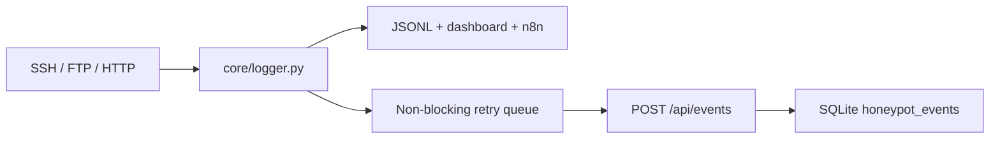

# Centralized Data Collection

Step 4 adds a backend collection API and a common SQLite event store for the Step 3 SSH, FTP, and HTTP records.

## Data flow



The existing JSONL path remains unchanged:

```text
data/raw_logs/honeypot_events.jsonl
```

It continues to support the dashboard, SSE stream, `simulation/n8n.py`, n8n and Telegram. The SQLite database is the new centralized backend store:

```text
website/backend/data/honeypot.db
```

The database file is runtime data and remains excluded from Git.

## Delivery behavior

- `log_event()` writes JSONL first.
- SSH, FTP and HTTP events are added to an in-memory backend queue.
- A single daemon worker sends them to `http://127.0.0.1:5000/api/events`.
- Honeypot responses never wait for the backend request.
- If the backend starts after `run.py` or temporarily stops, the worker retries queued events.
- A permanent HTTP 4xx validation rejection is dropped from the queue so later valid events are not blocked.
- JSONL remains the durable fallback if the queue fills or the Python process exits before delivery.
- `event_id` is unique in SQLite, so retrying the same event cannot create duplicates.

Only `ssh`, `ftp` and `http` records are sent to this centralized API during Step 4. Existing website logging remains unchanged.

## Environment variables

The defaults work with the existing five-terminal startup procedure.

| Variable | Default | Purpose |
|---|---|---|
| `EVENT_COLLECTOR_URL` | `http://127.0.0.1:5000/api/events` | Backend ingestion endpoint |
| `EVENT_COLLECTOR_TIMEOUT` | `2.0` | HTTP timeout in seconds |
| `EVENT_COLLECTOR_RETRY_SECONDS` | `2.0` | Delay between temporary-failure retries |
| `EVENT_COLLECTOR_QUEUE_SIZE` | `5000` | Maximum in-memory pending events |

Set an empty collector URL only when backend delivery must be disabled for isolated testing:

```powershell
$env:EVENT_COLLECTOR_URL=""
```

Do not set this during the normal Step 4 project run.

## API

### Store one event

```text
POST http://127.0.0.1:5000/api/events
Content-Type: application/json
```

Responses:

- `201` — new event stored
- `200` — duplicate `event_id` already stored
- `400` — common-schema validation failed
- `500` — database operation failed

### Read recent events

```text
GET http://127.0.0.1:5000/api/events?limit=100
```

Optional filters:

```text
service=ssh|ftp|http
severity=info|warning|critical
event_type=authentication|connection|command|request|attack
attack_type=<classification>
```

Example:

```text
http://127.0.0.1:5000/api/events?service=ftp&severity=warning&limit=20
```

### Read centralized statistics

```text
GET http://127.0.0.1:5000/api/events/stats
```

The response contains:

- `total_events`
- `by_service`
- `by_severity`
- `by_attack_type`

## SQLite table

The `honeypot_events` table stores every common schema field in queryable columns. `payload` and `metadata` are serialized as JSON text and converted back to JSON by the GET endpoint.

Indexes are created for:

- timestamp
- service
- severity
- attack type

## Tests

Python schema and delivery tests:

```powershell
cd D:\honeypot_v2
.\.venv\Scripts\Activate.ps1
python -m unittest discover -s tests -v
```

Backend SQLite tests:

```powershell
cd D:\honeypot_v2\website\backend
npm.cmd run test:events
```

Backend syntax checks:

```powershell
node --check server.js
node --check db.js
node --check event_store.js
node --check tests\event_store.test.js
```

## Security boundary

This collector is designed for the existing authorized local lab. Do not expose port 5000 or `/api/events` directly to the public internet. The database and JSONL logs can contain captured fake credentials and attack payloads; do not commit or share them.
