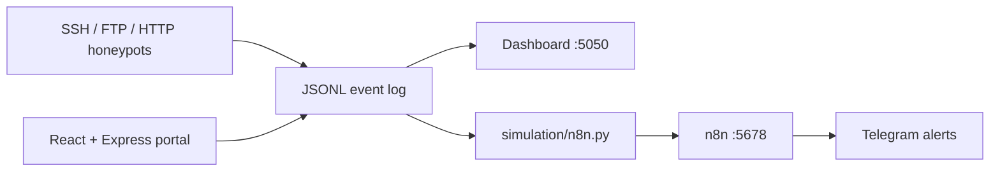

# Current System Workflow and Setup Guide

Project: A Secure and Intelligent Framework for Detecting and Understanding Malicious Digital Activities

Status: Step 2 documentation for the working baseline dated 14 July 2026.

This guide records the current working system exactly as it exists before Step 3. It is intended to let the project be assembled, started, tested, and safely restored on another Windows computer without replacing the existing functionality.

## 1. Current architecture



The Python launcher starts the SSH, FTP, and HTTP honeypots plus the monitoring dashboard. All honeypot events are appended to `data/raw_logs/honeypot_events.jsonl`. The Express backend also appends website events to this same log. The dashboard reads the log for monitoring, while `simulation/n8n.py` tails newly added records and sends them to the n8n webhook. The active n8n workflow applies its alert rules and sends eligible alerts to Telegram.

Current event records contain these fields:

- `timestamp`
- `source_ip`
- `service`
- `event`
- `attack_type`
- `payload`
- `severity`
- `metadata`

Do not change these fields during Step 2. A common event format for SSH, FTP, and HTTP will be introduced separately in Step 3.

## 2. Main components

| Component | Main file or directory | Purpose |
|---|---|---|
| Main launcher | `run.py` | Starts all Python honeypots and the dashboard |
| Service launcher | `core/launcher.py` | Runs SSH, FTP, HTTP, and dashboard services in threads |
| Central logger | `core/logger.py` | Writes JSONL events and supplies live dashboard events |
| SSH honeypot | `core/honeypots/ssh_honeypot.py` | Captures SSH connection and login activity |
| FTP honeypot | `core/honeypots/ftp_honeypot.py` | Provides a decoy FTP service and captures FTP activity |
| HTTP honeypot | `core/honeypots/http_honeypot.py` | Captures suspicious web requests and login activity |
| Python dashboard | `dashboard/app.py` | Displays log data, APIs, live events, and system status |
| Website backend | `website/backend/server.js` | Express API, SQLite user storage, and website event logging |
| Website frontend | `website/frontend/` | React/Vite portal |
| n8n forwarder | `simulation/n8n.py` | Tails the JSONL log and POSTs new events to n8n |
| Attack simulator | `simulation/simulate_attacks.py` | Generates controlled SSH, FTP, or HTTP test activity |
| Optional Flask portal | `run_website.py` | Runs the standalone portal used by the Cloudflare helper |
| Cloudflare helper | `scripts/start_website_tunnel.ps1` | Starts a quick or named Cloudflare tunnel |

## 3. Required software

Recommended environment:

- Windows 10 or Windows 11, 64-bit
- Git for Windows 2.54.0 or a compatible current version
- Python 3.12
- Node.js 22 LTS with npm
- n8n installed globally through npm
- Visual Studio Code, recommended but not required
- `cloudflared`, required only for the optional Cloudflare tunnel

Java, MySQL, MongoDB, and XAMPP are not required by the current project.

Confirm the main tools in PowerShell:

```powershell
git --version
py --version
node --version
npm.cmd --version
n8n.cmd --version
```

Install n8n if it is not already installed:

```powershell
npm.cmd install n8n -g
```

## 4. Project location and first-time installation

The commands below assume the project is located at:

```text
D:\honeypot_v2
```

### 4.1 Python environment

Open PowerShell and run:

```powershell
cd D:\honeypot_v2
py -3.12 -m venv .venv
Set-ExecutionPolicy -ExecutionPolicy RemoteSigned -Scope Process
.\.venv\Scripts\Activate.ps1
python -m pip install --upgrade pip
python -m pip install -r requirements.txt
python -m pip install -r XAI\requirements.txt
python -m pip install psutil
```

The main Python dependencies include Flask, pyftpdlib, PyYAML, and Requests. `psutil` supplies dashboard system statistics. The separate XAI requirements install the network libraries used by the XAI module.

### 4.2 Backend dependencies

Do not copy an old `node_modules` directory between computers. Install from the lock file:

```powershell
cd D:\honeypot_v2\website\backend
npm.cmd ci
```

Create `website\backend\.env` from `.env.example` and set:

```dotenv
PORT=5000
JWT_SECRET=replace_with_a_new_private_random_secret
FRONTEND_URL=http://localhost:5173
```

The `.env` file is private and must never be committed or shared.

### 4.3 Frontend dependencies

```powershell
cd D:\honeypot_v2\website\frontend
npm.cmd ci
```

The current frontend uses `http://localhost:5000` as its backend API address. Preserve that value for the local working setup.

## 5. Ports

| Service | Port | Normal address | Required for normal startup |
|---|---:|---|---|
| SSH honeypot | 2222 | `127.0.0.1:2222` | Yes |
| FTP honeypot | 2121 | `127.0.0.1:2121` | Yes |
| HTTP honeypot | 8080 | `http://127.0.0.1:8080` | Yes |
| Python dashboard | 5050 | `http://127.0.0.1:5050` | Yes |
| Express backend | 5000 | `http://localhost:5000` | Yes |
| React frontend | 5173 | `http://localhost:5173` | Yes |
| n8n | 5678 | `http://localhost:5678` | Yes |
| Optional Flask portal | 8090 | `http://127.0.0.1:8090` | No |

The honeypots may bind to all local interfaces (`0.0.0.0`). Keep them behind the Windows firewall and use them only in an authorized lab. Do not expose these ports directly to the public internet.

## 6. Environment variables and private data

### Main launcher terminal

Use this value before starting `run.py`:

```powershell
$env:N8N_WEBHOOK_URL=""
```

This intentionally disables direct n8n delivery from the central logger. The separate working forwarder, `simulation/n8n.py`, is responsible for sending newly recorded events to n8n. Keep this arrangement until a later enhancement explicitly changes it.

### Backend `.env`

| Variable | Working value or rule |
|---|---|
| `PORT` | `5000` |
| `JWT_SECRET` | A private, randomly generated secret unique to the computer |
| `FRONTEND_URL` | `http://localhost:5173` |

Never commit or share:

- `website/backend/.env`
- n8n credentials, bot tokens, chat IDs, or the `%USERPROFILE%\.n8n` directory
- database files
- captured logs or real credentials
- `.venv` and `node_modules`

Use only fake test credentials. The honeypots intentionally record submitted usernames, passwords, commands, paths, and request payloads in plaintext log data.

## 7. Exact normal startup procedure

Use five separate PowerShell terminals. Start the services in the following order.

### Terminal 1 — n8n

```powershell
cd D:\honeypot_v2
n8n.cmd start
```

Wait until n8n is available at `http://localhost:5678`.

### Terminal 2 — Python honeypots and dashboard

```powershell
cd D:\honeypot_v2
.\.venv\Scripts\Activate.ps1
$env:N8N_WEBHOOK_URL=""
python run.py
```

This starts SSH on 2222, FTP on 2121, HTTP on 8080, and the dashboard on 5050.

### Terminal 3 — Express backend

```powershell
cd D:\honeypot_v2\website\backend
npm.cmd run dev
```

### Terminal 4 — React frontend

```powershell
cd D:\honeypot_v2\website\frontend
npm.cmd run dev
```

### Terminal 5 — JSONL-to-n8n forwarder

```powershell
cd D:\honeypot_v2
.\.venv\Scripts\Activate.ps1
python .\simulation\n8n.py --mode local
```

The forwarder normally starts at the end of the existing JSONL file. Therefore, only new events written after Terminal 5 starts are forwarded. This prevents old events from generating repeated Telegram alerts.

## 8. n8n and Telegram setup

### 8.1 Preserve the current working configuration

The current Telegram bot was created by the project collaborator and already works through n8n. Do not create a replacement bot, change its token, or replace the active workflow when moving the project.

On the working computer, the live n8n state is normally stored at:

```text
%USERPROFILE%\.n8n
```

Stop n8n before backing up or restoring this directory. Treat the complete backup as a secret because it may contain encrypted credentials and encryption material. Do not place it inside the Git repository.

For another computer:

1. Install the same major version of n8n.
2. Stop n8n completely.
3. Securely restore the complete trusted `.n8n` backup to the new Windows user's `%USERPROFILE%\.n8n` directory.
4. Start n8n with `n8n.cmd start`.
5. Open `http://localhost:5678` and confirm that the working workflow is present.
6. Confirm that the webhook path is `honeypot-alert` and that only the intended alert workflow is active.
7. Start `simulation/n8n.py --mode local` and generate one controlled new event.

If the restored credential cannot be decrypted or the Windows user/profile changed, the bot owner or authorized collaborator must reconnect the existing Telegram credential. Do not expose the bot token in source code, screenshots, chat, Git, or a public workflow export.

### 8.2 Importing a sanitized workflow export

Use this only when a full trusted `.n8n` restore is unavailable:

1. Obtain a sanitized export of the known working workflow from the authorized collaborator.
2. Open n8n at `http://localhost:5678`.
3. Open the workflow menu and choose **Import from File**.
4. Select the sanitized JSON workflow.
5. Confirm that its webhook path is exactly `honeypot-alert`.
6. Configure the Telegram credential privately in the n8n user interface.
7. Verify its warning/critical filtering and rate-limiting behavior.
8. Activate only the intended workflow and test one new event.

Do not import or publish an export containing a bot token in an HTTP URL. The repository's workflow examples are not a substitute for the current secret-bearing working configuration unless they have been reviewed and sanitized first.

### 8.3 Telegram alert test

With all five terminals running, create one controlled test event. Check that:

- a new line appears in `data/raw_logs/honeypot_events.jsonl`;
- Terminal 5 reports delivery to the local n8n webhook;
- the n8n execution succeeds;
- the expected Telegram chat receives no more than the intended alert.

If no alert arrives, first confirm that the event severity meets the workflow's warning/critical rule and is not being suppressed by its per-IP cooldown.

## 9. Optional Cloudflare tunnel

Cloudflare is not required for the normal seven-service local workflow. The existing helper exposes the optional Flask portal running on `127.0.0.1:8090`.

First start the optional portal in its own PowerShell terminal:

```powershell
cd D:\honeypot_v2
.\.venv\Scripts\Activate.ps1
python run_website.py
```

For a temporary quick tunnel:

```powershell
cd D:\honeypot_v2
powershell -ExecutionPolicy Bypass -File .\scripts\start_website_tunnel.ps1
```

For an already configured named tunnel and hostname:

```powershell
cd D:\honeypot_v2
powershell -ExecutionPolicy Bypass -File .\scripts\start_website_tunnel.ps1 -UseNamedTunnel -TunnelName honeypot-site -Hostname honeypot.yourdomain.com
```

The React/Express portal currently uses localhost addresses and is not automatically configured for public Cloudflare hosting. Do not expose the n8n editor, dashboard, raw logs, SQLite database, backend development server, or honeypot control interfaces through Cloudflare.

## 10. Verification checklist

### 10.1 Port checks

Run these in another PowerShell window:

```powershell
Test-NetConnection 127.0.0.1 -Port 5050
Test-NetConnection 127.0.0.1 -Port 8080
Test-NetConnection 127.0.0.1 -Port 2121
Test-NetConnection 127.0.0.1 -Port 2222
Test-NetConnection 127.0.0.1 -Port 5000
Test-NetConnection 127.0.0.1 -Port 5173
Test-NetConnection 127.0.0.1 -Port 5678
```

Each running service should report `TcpTestSucceeded : True`.

### 10.2 Browser checks

Open:

- Dashboard: `http://127.0.0.1:5050`
- HTTP honeypot: `http://127.0.0.1:8080`
- Backend: `http://localhost:5000`
- React frontend: `http://localhost:5173`
- n8n: `http://localhost:5678`

### 10.3 Controlled simulation checks

Run one test type at a time from an activated virtual environment:

```powershell
cd D:\honeypot_v2
.\.venv\Scripts\Activate.ps1
python simulation\simulate_attacks.py --http-only
python simulation\simulate_attacks.py --ssh-only
python simulation\simulate_attacks.py --ftp-only
```

Use these only against the local project in an authorized environment.

For the existing website input test, use fake values such as:

```text
Username: admin' OR '1'='1 ; <script>alert('XSS')</script>
Password: test
```

Then verify the event in the dashboard, JSONL log, n8n execution, and Telegram alert as applicable.

## 11. Shutdown and restart

Stop each foreground service with `Ctrl+C` in its own terminal. Stop n8n before copying or restoring its state directory. After an unexpected shutdown, verify that ports 2222, 2121, 8080, 5050, 5000, 5173, and 5678 are free before restarting.

Normal restart order:

1. n8n
2. `python run.py`
3. Express backend
4. React frontend
5. `simulation/n8n.py --mode local`

## 12. Common troubleshooting

### PowerShell blocks virtual-environment activation

```powershell
Set-ExecutionPolicy -ExecutionPolicy RemoteSigned -Scope Process
.\.venv\Scripts\Activate.ps1
```

### PowerShell blocks `npm.ps1` or `n8n.ps1`

Use the Windows command shims shown in this guide:

```powershell
npm.cmd run dev
n8n.cmd start
```

### A port is already in use

Identify the process without forcefully terminating unrelated programs:

```powershell
Get-NetTCPConnection -LocalPort 5050 -ErrorAction SilentlyContinue
Get-NetTCPConnection -LocalPort 5678 -ErrorAction SilentlyContinue
```

Stop the duplicate project process from its original terminal, then restart in the documented order.

### Events appear in the dashboard but not in n8n

Check that Terminal 5 is still running, the webhook address is `http://localhost:5678/webhook/honeypot-alert`, the workflow is active, and the event was created after the forwarder started.

### n8n receives the event but Telegram does not

Check the n8n execution result, severity filter, per-IP cooldown, active Telegram credential, and authorized chat configuration. Ask the bot owner to repair the existing credential if necessary; do not place its token in project files.

### Frontend cannot reach the backend

Confirm that the backend is listening on port 5000, the frontend is on 5173, and `FRONTEND_URL=http://localhost:5173` is present in the backend `.env`.

## 13. Step 2 completion conditions

Step 2 is complete when another Windows computer can:

- install the documented dependencies;
- start all seven normal services on their recorded ports;
- open the dashboard, honeypot, backend, frontend, and n8n interfaces;
- generate controlled SSH, FTP, and HTTP events;
- see new events in `data/raw_logs/honeypot_events.jsonl` and the dashboard;
- forward new events through `simulation/n8n.py` to the existing n8n workflow;
- receive the expected Telegram alert using the securely restored existing configuration;
- optionally start the standalone Cloudflare portal without exposing private services.

No working source code or runtime behavior is changed by this document.
