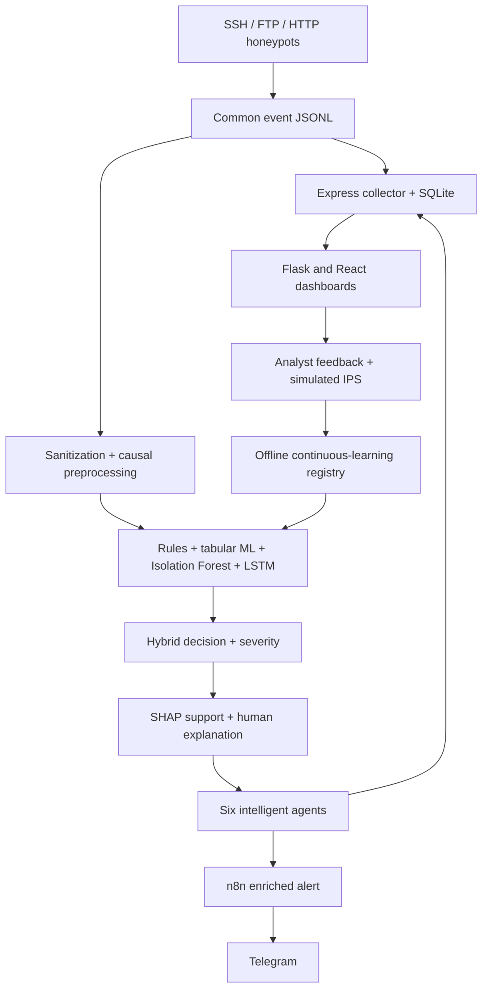
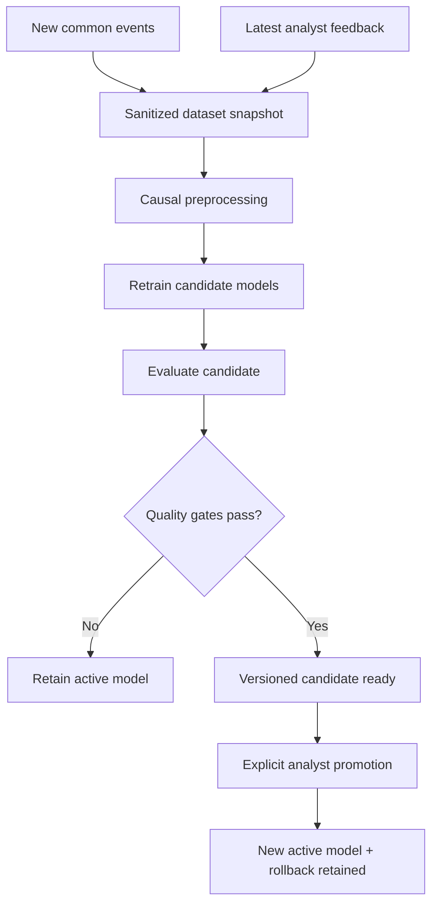

# Final System Workflow

Project: A Secure and Intelligent Framework for Detecting and Understanding Malicious Digital Activities

Status: Complete academic prototype through continuous learning, final testing, documentation, and demonstration preparation.

## 1. Runtime architecture



## 2. Live processing sequence

1. A local authorized request reaches SSH `2222`, FTP `2121`, or HTTP `8080`.
2. The honeypot builds a common schema event and appends it to `data/raw_logs/honeypot_events.jsonl`.
3. The logger asynchronously delivers the event to the Express collector; JSONL remains the durable fallback.
4. The real-time IDS tails the event log and applies the same sanitized preprocessing and causal feature contract used for training.
5. Rules, the selected Decision Tree/Random Forest classifier, Isolation Forest, and LSTM contribute to one hybrid decision.
6. Threat reporting assigns Low, Medium, High, or Critical.
7. XAI adds supporting SHAP feature contributions and a privacy-safe human explanation.
8. Detection, correlation, severity, explanation, response, and daily-report agents run in a fixed order without changing the protected IDS decision.
9. The final record is appended to `data/detections/hybrid_ids_results.jsonl` and delivered to SQLite.
10. Authenticated dashboards display totals, distributions, source/service views, confidence, XAI, agent analysis, feedback, and simulated response history.
11. `simulation/n8n.py --source ids` forwards only new enriched IDS records. High/Critical attacks pass the alert filter and reach Telegram.
12. An analyst can confirm the incident, mark a false positive, override severity, add notes, and choose a safe simulated response.

## 3. Stored data

| Store | Content | Git status |
|---|---|---|
| `data/raw_logs/honeypot_events.jsonl` | Common honeypot events | Ignored |
| `data/detections/hybrid_ids_results.jsonl` | Final IDS, XAI, and agent output | Ignored |
| `website/backend/data/honeypot.db` | Users, events, IDS results, feedback, IPS audit | Ignored |
| `data/ml_ready/` | Active preprocessor, models, evaluation | Ignored |
| `data/ips/` | Safe simulated IPS runtime state | Ignored |
| `data/reports/` | Agent and final-system reports | Ignored |
| `data/continuous_learning/` | Dataset/model versions, registry, rollbacks | Ignored |

## 4. Common event contract

Every supported honeypot emits the versioned schema containing identity, time, network, service, request, activity, status, payload, metadata, and severity fields. The training dataset replaces source IP with a salted hash/scope, redacts credentials, excludes direct identifiers, and keeps raw text out of direct model inputs.

## 5. Detection contract

Final IDS records contain at least:

```text
event_id
timestamp
service
attack_type
prediction
confidence
anomaly_score
model_used
threat_level
threat_score
components
fusion_reason
xai
agents
integration safety flags
```

Producer `attack_type` is never used as the model prediction target during live inference.

## 6. Continuous-learning workflow



False-positive feedback changes the next training label to `normal`. Confirmed attacks retain a supported attack label. Analyst identity, notes, and severity override are not model features. Retraining never edits the active artifacts. Promotion is explicit, services must be stopped, hashes are verified, and the previous active tree is retained.

## 7. Simulated IPS boundary

Available actions are recommendation, simulate block, rate limit, terminate a selected honeypot session, and release/undo. They affect only application-level prototype state. The hard safety contract is:

```text
mode = simulation
automatic_host_blocking = false
host_firewall_changed = false
```

No code path invokes `netsh`, PowerShell firewall commands, `iptables`, or shell-based host blocking.

## 8. Authentication

The React portal owns local signup/login through Express, bcrypt, JWT, and SQLite. The Flask dashboard uses the same portal login and validates its session through the backend. Event, IDS, feedback, and IPS analyst APIs require authentication; ingestion and the public simulated-IPS safety statement remain available to the local pipeline.

## 9. Startup order

1. n8n
2. Express backend
3. React frontend
4. `python run.py`
5. `python .\simulation\n8n.py --mode local --source ids`

See `howtostart.md` for exact commands.

## 10. Verification levels

- Focused unit tests validate schema, preprocessing, model safety, fusion, XAI, agents, feedback, IPS, continuous learning, and final result contracts.
- Backend Node tests validate SQLite stores, authentication boundaries, feedback, and IPS actions.
- Frontend production build validates the React/Vite application.
- `scripts/final_system_test.py --runtime` validates live ports and HTTP services.
- `--simulate-attacks` creates all seven local scenarios and verifies raw events, IDS/XAI/agents, and SQLite persistence.
- `--n8n-check` verifies enriched webhook acceptance; Telegram receipt is visually confirmed.

## 11. Honest scope

The roadmap is implemented for an academic prototype. Remaining work is production hardening: external validation data, larger real-world datasets, TLS and deployment controls, rotating/retaining large logs, stronger user/role administration, full observability, independent security review, and authorized infrastructure deployment.
