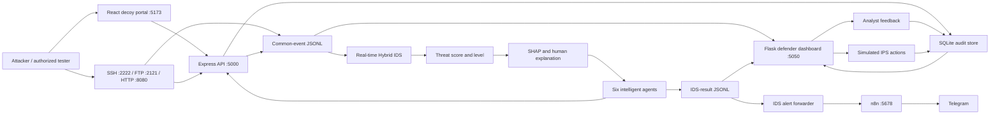
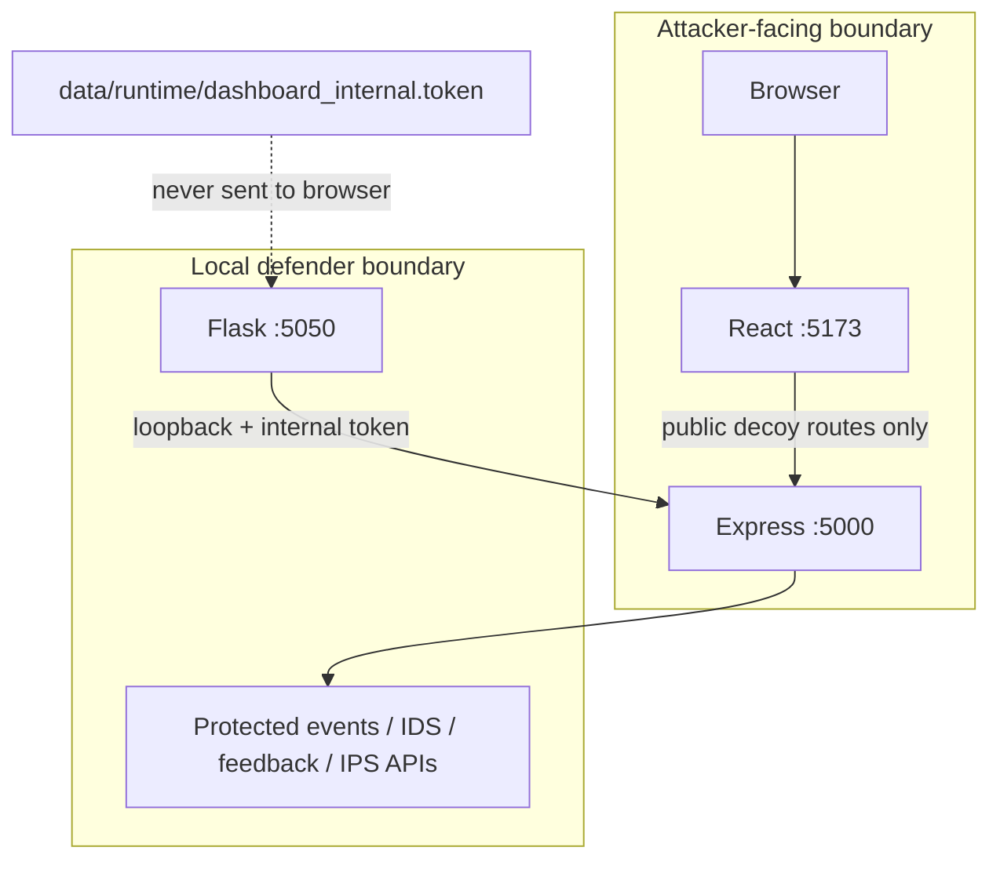
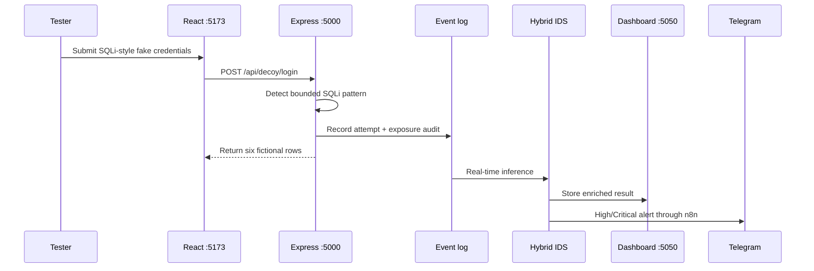
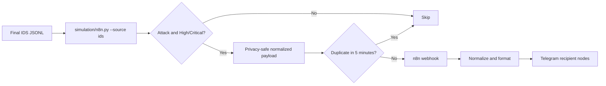
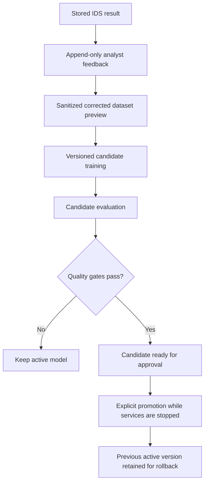

# Mock Implementation Report

## A Secure and Intelligent Framework for Detecting and Understanding Malicious Digital Activities

**Implementation branch:** `mock`  
**Implementation baseline:** commit `a4f8382`  
**Report date:** 6 September 2026  
**Status:** Complete academic and authorized-local-lab prototype

---

## Contents

1. Executive summary
2. Objectives and implemented decisions
3. Runtime services
4. High-level architecture
5. Trust boundaries and separation
6. Source-code map
7. Common event and storage workflow
8. Attacker-facing portal
9. Hybrid IDS
10. XAI and intelligent agents
11. Defender dashboard section-by-section
12. Alert and Telegram workflow
13. Analyst feedback and continuous learning
14. Startup, demonstration, and verification
15. Current strengths
16. Known limitations
17. Recommended future upgrades
18. Conclusion

## 1. Executive summary

This implementation is a multi-service cybersecurity demonstration platform. It combines attacker-facing decoys, centralized telemetry, rule-based and machine-learning detection, explainable AI, intelligent post-detection agents, analyst feedback, simulated prevention actions, reporting, and Telegram alerts.

The principal design decision is strict separation between two experiences:

- Port **5173** presents a believable fictional company portal to an attacker or demonstration participant.
- Port **5050** presents a localhost-only defender console containing monitoring, IDS, XAI, intelligent-agent, feedback, IPS, and reporting tools.

The portal safely demonstrates what an attacker might appear to obtain from SQL injection or XSS. It never executes arbitrary SQL, exposes a real database, or executes submitted JavaScript. The displayed records are fixed fictional data, and the exact simulated exposure is preserved in the audit trail.

The project is suitable for classroom demonstration, research prototyping, and controlled local testing. It is not a production SOC, production WAF, or replacement for a real IDS/IPS platform.

## 2. Objectives and implemented decisions

| Requirement | Implementation decision | Why |
|---|---|---|
| Separate attacker and defender interfaces | React portal on `5173`; Flask dashboard on `5050` | Prevents the attacker-facing portal from exposing analyst data and controls |
| Remove dashboard login/signup UI | Port `5050` opens directly and binds only to loopback | Makes the local demonstration faster while retaining a security boundary |
| Preserve protected backend APIs | Flask uses a server-side internal token when calling Express | The credential never reaches browser JavaScript or port `5173` |
| Demonstrate SQL injection impact | Return six deterministic fictional employee rows | Shows a believable result without accessing a real SQL database |
| Demonstrate XSS impact | Return four fictional cached records and fake session context | Shows browser-data exposure without executing unrestricted JavaScript |
| Keep decoy files | Portal lists and serves tracked fictional company files | Provides additional interaction and directory/file-access telemetry |
| Retain alerts and dashboards | All decoy attempts enter the common event and IDS pipelines | Keeps monitoring, XAI, agents, IPS, and Telegram behavior connected |
| Prevent harmful response actions | IPS is simulation-only and host firewall modification is hard-disabled | Makes prevention behavior demonstrable and auditable without affecting the host |

## 3. Runtime services

| Port | Component | Audience | Responsibility |
|---:|---|---|---|
| `2222` | SSH honeypot | Attacker/tester | Captures connections and authentication behavior |
| `2121` | FTP honeypot | Attacker/tester | Captures logins, commands, and decoy-file activity |
| `8080` | HTTP honeypot | Attacker/tester | Captures web login attempts, SQLi, XSS, and scanning |
| `5000` | Express backend | Internal application layer | Receives events/results and stores SQLite audit data |
| `5050` | Flask defender dashboard | Local defender | Displays monitoring, IDS, XAI, agents, IPS, and reports |
| `5173` | React/Vite company portal | Attacker/tester | Presents decoy login, search, files, and safe attack-result simulations |
| `5678` | n8n | Alert automation | Receives eligible enriched alerts and delivers Telegram notifications |

The services are intentionally separate processes. This allows the attacker portal, backend, defender dashboard, detection pipeline, and alert workflow to fail or restart independently.

## 4. High-level architecture



## 5. Trust boundaries and separation



Port `5050` accepts only `127.0.0.1`, `localhost`, or `::1`. Its internal credential is created in ignored runtime storage, read by Flask and Express, compared using timing-safe equality, and accepted only from a loopback request. Existing JWT support remains in the backend for legacy administrative scripts, but the current 5050 UI has no login, signup, or logout workflow.

## 6. Source-code map: where each capability is implemented

| Capability | Primary location |
|---|---|
| Service launcher | `run.py`, `core/launcher.py` |
| SSH, FTP, HTTP honeypots | `core/honeypots/` |
| Common event schema and logging | `core/event_schema.py`, `core/logger.py` |
| Dataset labeling and preparation | `dataset/` |
| Preprocessing and causal sequences | `preprocessing/preprocess_dataset.py` |
| Behavioral feature engineering | `feature_engineering/engineer_features.py` |
| Deterministic detection rules | `rule_based_detection/` |
| Model training and evaluation | `machine_learning/train_models.py`, `train_lstm.py`, `evaluate_models.py` |
| Hybrid inference | `machine_learning/hybrid_ids.py` |
| Real-time IDS integration | `machine_learning/realtime_ids.py` |
| Threat scoring | `machine_learning/threat_reporting.py` |
| SHAP and human explanation | `XAI/prediction_explainer.py` |
| Intelligent agents | `intelligent_agents/agents.py`, `orchestrator.py` |
| Defender dashboard | `dashboard/app.py`, `dashboard/templates/index.html` |
| Internal dashboard access | `website/backend/middleware/dashboard_access.js` |
| SQLite stores and protected APIs | `website/backend/*_store.js`, `website/backend/server.js` |
| SQLi/XSS fictional results | `website/backend/decoy_simulation.js` |
| Attacker portal UI | `website/frontend/src/pages/HomePage.jsx`, `ExposurePanel.jsx` |
| Alert normalization and filtering | `simulation/n8n.py` |
| Base n8n workflow | `simulation/honeypot-alert.workflow.json` |
| Simulated IPS | `website/backend/ips_response_store.js`, `core/simulated_ips.py` |
| Continuous learning | `continuous_learning/` |
| End-to-end verification | `scripts/final_system_test.py` |

## 7. Common event and storage workflow

Every supported activity is normalized into one versioned event contract. Important fields include:

```text
event_id, schema_version, timestamp
source_ip, source_port, destination_port
service, protocol, event_type, event, attack_type
severity, status, username, session_id
request_method, request_path, payload, metadata
```

The same event is used for dashboard activity, dataset creation, IDS inference, correlation, and auditing. Direct identifiers and raw sensitive values are excluded from model features. Dataset preparation hashes source addresses, sanitizes sensitive content, and retains only approved fields.

Persistence is deliberately redundant:

| Store | Purpose |
|---|---|
| `data/raw_logs/honeypot_events.jsonl` | Durable append-only common-event stream and IDS input |
| `data/detections/hybrid_ids_results.jsonl` | Final IDS, threat, XAI, and agent results |
| `website/backend/data/honeypot.db` | Queryable centralized events, IDS results, feedback, and IPS audit |
| `data/reports/agents/` | Privacy-safe daily agent summaries |
| `data/ips/` | Application-level simulated IPS state |

Generated runtime data is ignored by Git. Source code and safe templates are versioned; tokens, logs, databases, credentials, local n8n state, virtual environments, and model runtime artifacts are not published.

## 8. Attacker-facing portal on port 5173

### 8.1 Normal behavior

The portal is branded as a fictional company resource system. It contains:

- an employee sign-in form;
- a company-resource search form;
- a list of shared decoy files;
- ordinary company statistics and presentation content.

The sign-in form is not the defender login. It is a honeypot entry point. The React application calls only the dedicated decoy endpoints and does not store a dashboard JWT or expose analyst navigation.

### 8.2 SQL injection simulation

When SQLi syntax is detected in the decoy login input:

1. Express classifies the input using bounded patterns.
2. The route creates `website_decoy_login_sql_injection` telemetry.
3. A safe result object identifies a fictional database and table.
4. Six fixed fictional employee records are returned to React.
5. React renders values as text nodes; no database query is executed.
6. The exact displayed columns, rows, entry point, and safety flags are stored in `exposureAudit`.
7. The raw event proceeds through IDS, dashboard, XAI, agents, IPS recommendation, and alerting.



### 8.3 XSS simulation

When XSS syntax is detected in login or search input:

1. Express records an XSS event.
2. It returns a fictional browser-cache exposure containing four employee records, a fake session value, and a fake user identity.
3. No submitted script is evaluated.
4. React escapes and renders the data safely.
5. `real_database_access`, `unrestricted_javascript`, and equivalent safety flags remain false.
6. The attempt and displayed result are retained for defender review.

### 8.4 Decoy-file behavior

The `/files` and `/files/:filename` routes expose only configured fictional files. File access and missing/suspicious filenames are logged. Traversal-like values and sensitive-path probes are classified as directory scanning rather than being passed to unrestricted filesystem access.

## 9. Hybrid IDS implementation

The real-time IDS tails the common-event JSONL file. For each new event it applies the same preprocessing contract used at training time, constructs only causal historical features, and invokes four complementary detection components.

| Component | Function |
|---|---|
| Rules | High-confidence signatures and thresholds for known attack behavior |
| Decision Tree | Current selected interpretable tabular classifier |
| Random Forest | Evaluated ensemble candidate retained for comparison |
| Isolation Forest | Normal-only, label-free anomaly signal |
| LSTM (active) | Sequence classifier for temporal behavior and repeated activity; legacy chronological split |
| LSTM (audit candidates) | Source-IP-hash group-isolated robustness evaluation; not promoted to runtime |

The fusion layer produces one protected decision with `prediction`, `attack_type`, `confidence`, `anomaly_score`, `model_used`, component evidence, and a fusion reason. Producer-supplied `attack_type` is not accepted as the model prediction during live inference.

### 9.1 Current controlled evaluation snapshot

The current local evaluation artifacts report:

| Model | Accuracy | Balanced accuracy | Macro F1 | Interpretation |
|---|---:|---:|---:|---|
| Decision Tree | `0.9804` | `0.9465` | `0.9582` | Current selected tabular model |
| Random Forest | `0.9645` | `0.9408` | `0.9510` | Retained ensemble candidate |
| LSTM — legacy chronological holdout | `1.0000` | `1.0000` | `1.0000` | Reproduced on 816 saved sequences; optimistic due to related-group/template overlap |
| LSTM — source-group-isolated audit (3-run mean) | `0.9761 ± 0.0035` | `0.9785` | `0.9675 ± 0.0033` | Preferred internal estimate; seeds 42–44, zero source-group overlap |
| Isolation Forest | `0.1140` | `0.5095` | Not directly comparable | Normal-only anomaly detector evaluated through a separate binary view; threshold/data tuning is required |

The legacy `1.0000` result is not interpreted as proof of perfect generalization. Audit evidence shows that 791 of 816 legacy test rows (`96.94%`) have a source hash already present in training, all 816 reuse a service/event/path template found in training, and the chronological boundary timestamp is identical. No byte-identical train/test sequences were found, so the concern is related-group/template overlap rather than literal duplicate sequences.

A leakage-resistant audit was therefore run with `source_ip_hash` as the grouping key. Each of three seeds created group-isolated train/validation/test partitions, fitted preprocessing on training rows only, built sequences within the isolated partitions, and retained the best checkpoint by validation loss. Test accuracy was `0.9761` mean with `0.0035` population standard deviation (range `0.9718–0.9803`); macro F1 was `0.9675` mean with `0.0033` standard deviation (range `0.9635–0.9715`). The mean balanced accuracy was approximately `0.9785`. Source-group overlap was zero in every train/test and train/validation split. Templates still repeat across groups, so an external or template/campaign-isolated holdout remains necessary. The active runtime checkpoint was not modified; the packaged seed-42 model and preprocessor are audit candidates only.

### 9.2 Threat score

Threat reporting does not retrain or alter the classifier. It combines attack-type weight, confidence, repetition, service sensitivity, and anomaly evidence into a score from 0 to 100.

| Score | Threat level |
|---:|---|
| `0-24` | Low |
| `25-49` | Medium |
| `50-74` | High |
| `75-100` | Critical |

Repeated incidents are counted causally within a 60-second window. This lets a sequence of related attempts escalate without using future events.

## 10. XAI and intelligent agents

### 10.1 Explainable AI

SHAP explains the selected tree-model contribution where applicable. The XAI result separates:

- model decision evidence;
- top positive or opposing feature contributions;
- rule and sequence evidence;
- confidence and threat score;
- a deterministic human-readable explanation;
- privacy flags confirming that raw payloads and credentials are not included.

SHAP is supporting evidence, not proof of causation. LSTM-only or rule-only decisions receive appropriate deterministic explanations rather than misleading tree SHAP claims.

### 10.2 Six-agent pipeline

After the protected IDS result is produced, the ordered agent pipeline performs:

1. **Detection agent:** summarizes the final IDS decision.
2. **Correlation agent:** groups related source activity into a campaign window.
3. **Severity agent:** recommends retention or escalation based on correlation.
4. **Explanation agent:** combines model and correlation evidence into safe prose.
5. **Response agent:** recommends a simulation-only action.
6. **Daily report agent:** updates privacy-safe IST daily statistics.

Agents cannot overwrite the original prediction, attack type, threat level, threat score, or XAI object. The orchestrator compares protected fields before and after execution. Daily-report file replacement is retried; if Windows temporarily locks the file, report persistence is deferred and IDS processing continues.

## 11. Defender dashboard on port 5050

The dashboard is a single localhost-only defender console. It contains no login, signup, or logout controls. Browser requests stay same-origin to Flask. Flask performs protected Express requests server-to-server using the internal dashboard credential.

### 11.1 System Monitor

The System Monitor answers: **What is happening right now?**

It displays:

- uncapped centralized total-event count;
- warning and critical event count;
- unique source-address count;
- process uptime;
- correlated port-scan status and observed ports;
- CPU and RAM utilization;
- newest-first live event rows with timestamp, service, attack, severity, and event name.

Two update mechanisms are used:

- SSE immediately adds events generated inside the Python honeypot process.
- A 10-second `/api/monitor` synchronization reads recent durable events, ensuring React/Express events also appear even though they originate in a different process.

The monitor uses SQLite for uncapped totals and limits only the visible table to the latest 100 records. The feed is deliberately rebuilt newest-first so recent SQLi and XSS are visible at the top.

### 11.2 Honeypot Services

The Honeypot section answers: **Which decoy service was touched and what was captured?**

It presents per-service cards for SSH, FTP, HTTP, and website traffic, recent activity tables, threat counts, and extracted demonstration credentials. SQLi/XSS entries from the 5173 portal appear alongside network honeypot activity. When a simulated exposure occurred, the stored audit describes exactly which fictional rows were displayed.

Captured credentials are demonstration telemetry and must always be fake. They are shown only on the local defender dashboard and are excluded from Telegram and XAI payloads.

### 11.3 Intrusion Detection System

The IDS section answers: **How did the detection engine classify the activity?**

It contains:

- total processed results and attack predictions;
- active threats from the configured recent window;
- average model confidence;
- Critical-incident count;
- attack-type breakdown and severity distribution;
- service-wise attack statistics;
- top source addresses and an attack timeline;
- searchable/filterable live results by service, attack, severity, and model;
- a detailed incident modal containing fusion, component, threat, XAI, and feedback information.

This section reads final IDS results rather than raw producer labels. It therefore represents the detection engine's conclusion, not merely the honeypot's initial observation.

### 11.4 Explainable AI

The XAI section answers: **Why was this decision made, and what does the analyst think?**

It provides a review queue, model confidence, threat score, human reason, SHAP feature contributions, privacy status, and report generation. Review statistics show confirmed attacks, false positives, awaiting-review results, and severity overrides.

Analysts can append a verdict, optional severity override, and notes. Feedback is append-only: it does not mutate the historical IDS result. The latest verdict can influence simulated IPS policy and later offline continuous-learning data preparation.

### 11.5 Intelligent Agents

The Agents section answers: **What automated post-detection analysis was performed?**

It displays analyzed-result counts, campaign counts, escalation counts, report date, and the latest output from each ordered agent. The page explicitly shows that agents are bounded post-processing components rather than autonomous model trainers or firewall controllers.

### 11.6 Simulated IPS Response

The IPS section answers: **What defensive response is recommended, approved, and audited?**

Policy defaults are:

| Effective severity | Default policy |
|---|---|
| Low | Continue monitoring |
| Medium | Honeypot-level rate limit |
| High | Recommend a simulated block |
| Critical | Simulated block |

Available analyst actions include recommendation, simulated block, rate limit, selected-session termination, release/undo, and dismissal. Durations are bounded, repeated activity can affect recommendations, and false-positive feedback suppresses or reverses active simulated responses.

The non-negotiable safety contract is:

```text
mode = simulation
automatic_host_blocking = false
host_firewall_changed = false
```

No code path invokes Windows Firewall, `netsh`, `iptables`, or an unrestricted shell command.

### 11.7 Security Report

The Report section answers: **How can the current evidence be summarized or exported?**

It includes totals, threats, unique sources, demonstration credential count, attack-type summary, recent threats, and a full text preview. The same report can be downloaded as `.txt` for a demonstration or appendix.

## 12. Alert and Telegram workflow



The forwarder consumes final IDS records, not raw honeypot rows. This is necessary because alert messages require final prediction, confidence, threat level, XAI summary, agent analysis, and IPS recommendation.

Only attack predictions at High or Critical are immediately eligible. Portal events also require consistent portal evidence to prevent unrelated normal page telemetry from becoming alerts. Repeated alerts with the same source, attack, service, and target are suppressed for five minutes.

Sensitive keys such as raw payload, username, password, credentials, token, authorization, and secret are removed from the alert record. Local n8n credentials and recipient identifiers remain outside Git. The repository workflow contains safe webhook/normalization structure; recipient delivery nodes are configured locally. Delivery nodes use retry behavior and continue independently so one unavailable recipient does not block valid recipients. Every configured Telegram chat must still have a valid chat identifier and permission to receive messages.

## 13. Analyst feedback and continuous learning



Continuous learning is offline and analyst-controlled. Live IDS processing never calls model fitting. A false-positive verdict maps the candidate training label to normal; confirmed attacks retain an approved attack label. Analyst identity, free-text notes, and severity override are not model input features.

Candidates are versioned and compared using macro F1, macro recall, false-positive rate, and minimum-row quality gates. Promotion and rollback require explicit commands and stopped model consumers.

## 14. Startup, demonstration, and verification

The supported startup order is:

1. n8n on `5678`.
2. Express backend on `5000`.
3. React portal on `5173`.
4. `run.py` for honeypots, real-time IDS, agents, and dashboard.
5. `simulation/n8n.py --mode local --source ids` for enriched alerts.

Exact commands are maintained in `howtostart.md`.

Verification is layered:

- Python unit and integration tests validate schema, labeling, preprocessing, models, fusion, threat scoring, XAI, agents, dashboard behavior, IPS safety, and continuous learning.
- Node tests validate centralized storage, internal dashboard access, decoy simulation, feedback, and IPS actions.
- The frontend production build validates React/Vite compilation.
- `scripts/final_system_test.py` checks offline artifacts and test suites.
- `--runtime` checks all seven live ports and HTTP services.
- `--simulate-attacks` runs controlled SSH, FTP, SQLi, XSS, scanning, and normal scenarios.
- `--n8n-check` verifies webhook acceptance; Telegram receipt is externally and visually confirmed.

## 15. Current strengths

- Clear attacker/defender separation.
- One common event contract across heterogeneous honeypots.
- Durable JSONL fallback plus queryable SQLite storage.
- Hybrid detection rather than reliance on one model.
- Causal sequence and repetition processing.
- Explicit four-level threat scoring.
- XAI with honest scope and privacy controls.
- Bounded agents that cannot rewrite protected IDS decisions.
- Safe, deterministic SQLi/XSS impact demonstrations.
- Auditable analyst feedback and reversible simulated responses.
- High/Critical enriched alerting with deduplication and recipient isolation.
- Offline, versioned continuous learning with promotion gates and rollback.
- Automated regression and end-to-end verification.

## 16. Known limitations

- The dataset contains a significant controlled/synthetic component.
- Current model metrics demonstrate performance on this dataset, not production generalization.
- The active LSTM still reports `1.0000` on the legacy controlled split, but the preferred source-group-isolated estimate is `0.9761 ± 0.0035` accuracy and `0.9675 ± 0.0033` macro F1 across three seeds.
- Source grouping removes source identity overlap, but the controlled dataset still reuses service/event/path templates across groups; external/template/campaign generalization is not yet established.
- SQLite and JSONL are suitable for a prototype but need retention, indexing, backup, and concurrency planning at production volume.
- Flask and Express development servers are not production deployment servers.
- The dashboard is localhost-only and intentionally has no multi-user RBAC.
- n8n/Telegram delivery depends on external connectivity and correct recipient configuration.
- Simulated IPS actions do not protect a real network.
- The SSH service is a controlled honeypot protocol implementation, not hardened OpenSSH.
- There is no independent red-team assessment or production privacy review.

## 17. Recommended future upgrades

### Priority 1: trustworthy model evaluation

1. Create a permanent external holdout set with unseen payload templates, sources, sessions, and time periods. **Still required.**
2. Split by source/session group so related sequences cannot cross train and test boundaries. **Implemented for the LSTM audit using source-IP hash groups.**
3. Build test sequences exclusively from holdout rows. **Implemented for each isolated audit partition.**
4. Remove semantic near-duplicates, not only duplicate event IDs.
5. Add obfuscated SQLi/XSS variants and benign hard negatives containing suspicious punctuation or keywords.
6. Add validation-based early stopping and probability calibration for the LSTM. **Validation-loss checkpointing is implemented in the audit; probability calibration remains.**
7. Report macro F1, per-class precision/recall, balanced accuracy, false-positive rate, and confidence calibration alongside accuracy. **Core classification metrics are now reported; calibration remains.**
8. Run multiple temporal/grouped folds and publish mean plus variance. **Three grouped seeds with mean, population standard deviation and range are now reported; more folds and formal intervals remain desirable.**

The audit deliberately did not manipulate scores. It changed the evaluation design to reduce related-source leakage and obtained a credible, slightly lower internal estimate. The next goal is stronger template/campaign and external isolation, not an arbitrarily lower number.

### Priority 2: monitoring and operations

1. Replace process-local SSE queues with a broadcast event bus such as Redis Streams or a message broker.
2. Add log rotation, database retention policies, archive integrity hashes, and backup/restore tests.
3. Add health endpoints for each service and a supervisor that reports degraded components.
4. Add structured application metrics, tracing, delivery latency, and alert-failure dashboards.
5. Add n8n dead-letter handling and recipient health checks without storing secrets in Git.

### Priority 3: defender experience

1. Add attack-only and all-activity feed modes.
2. Add incident grouping by source, session, campaign, and time window.
3. Add drill-down links from Monitor to the matching IDS/XAI/IPS record.
4. Add exportable JSON/PDF incident reports with configurable redaction.
5. Add optional local RBAC only if the dashboard is ever exposed beyond loopback.

### Priority 4: portal and honeypot realism

1. Expand deterministic decoy datasets while preserving fictional-data guarantees.
2. Add more safe web attack simulations such as traversal outcomes, command-injection indicators, and API abuse without executing user input.
3. Vary response timing and content to reduce obvious repetition.
4. Add protocol banners and stateful decoy sessions while maintaining containment.

### Priority 5: production security research

1. Containerize and isolate each service on an explicitly authorized lab network.
2. Add TLS, secret rotation, least-privilege service identities, and signed artifact manifests.
3. Perform dependency scanning, SAST, DAST, and independent code review.
4. Define privacy, consent, retention, and evidence-handling policies before capturing non-synthetic traffic.
5. Never enable real automated blocking until policy, rollback, rate limits, allowlists, and human override have been independently validated.

## 18. Conclusion

The `mock` implementation fulfills its intended academic objective: an attacker can interact with realistic decoy services and safely observe fictional SQLi/XSS outcomes, while a separate local defender can follow the same activity through monitoring, IDS classification, XAI, intelligent agents, analyst review, simulated IPS actions, reports, and Telegram alerts.

The source-group-isolated LSTM audit resolves the immediate concern that the only reported accuracy was `1.0000`, while honestly showing strong controlled-data performance. External and template/campaign-isolated validation remains the next milestone. The results support an academic prototype, not production-security guarantees.
