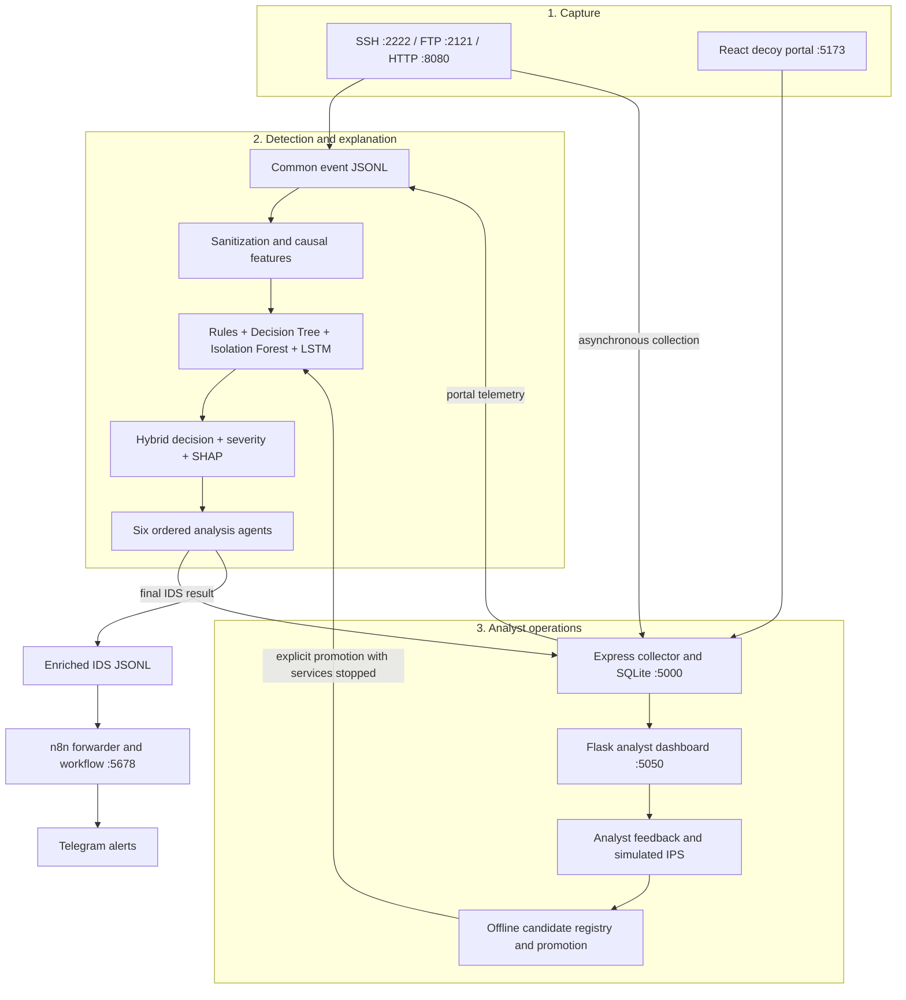
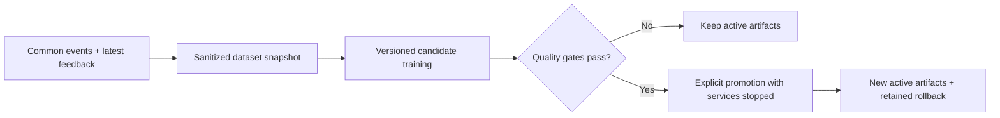

# Intelligent Honeypot Security Framework

### A Secure and Intelligent Framework for Detecting and Understanding Malicious Digital Activities

[](https://www.python.org/)
[](#10-technology-stack)
[](website/frontend/)
[](#6-hybrid-detection-engine)
[](#7-explainability-and-intelligent-agents)
[](#17-security-boundaries-and-limitations)

A Windows-based cybersecurity research platform that captures activity through **SSH, FTP, and HTTP honeypots**, combines **rules, machine learning, and LSTM sequence analysis**, and presents explainable findings through an analyst dashboard. The platform includes a React company decoy, centralized event storage, analyst feedback, simulated response controls, and enriched Telegram alerts through n8n.

**Evaluation snapshot:** 710 test rows · 23 encoded features · 8 classes · **98.31% Decision Tree accuracy** · **97.15% LSTM macro F1**.

> Designed for controlled demonstrations and authorized research. Response controls operate at the prototype application level; the framework does not change the host firewall. Reported model results apply to the evaluated project dataset.

---

## Table of Contents

- [1. Project Overview](#1-project-overview)
- [2. Problem Statement and Objectives](#2-problem-statement-and-objectives)
- [3. Key Features](#3-key-features)
- [4. System Architecture](#4-system-architecture)
- [5. Event Processing and Feature Engineering](#5-event-processing-and-feature-engineering)
- [6. Hybrid Detection Engine](#6-hybrid-detection-engine)
- [7. Explainability and Intelligent Agents](#7-explainability-and-intelligent-agents)
- [8. Evaluation Results](#8-evaluation-results)
- [9. Analyst Dashboard and Simulated IPS](#9-analyst-dashboard-and-simulated-ips)
- [10. Technology Stack](#10-technology-stack)
- [11. Installation and Environment Setup](#11-installation-and-environment-setup)
- [12. Running the System](#12-running-the-system)
- [13. Controlled Demonstration](#13-controlled-demonstration)
- [14. Continuous Learning](#14-continuous-learning)
- [15. Testing and Verification](#15-testing-and-verification)
- [16. Repository Structure](#16-repository-structure)
- [17. Security Boundaries and Limitations](#17-security-boundaries-and-limitations)
- [18. Documentation and References](#18-documentation-and-references)

---

## 1. Project Overview

The framework connects attack capture, intrusion detection, explanation, and analyst review in one local research workflow. A request to a honeypot or decoy portal becomes a structured event. The live IDS examines the event and its earlier activity context, produces a classification and threat score, attaches explanations, and persists the result for investigation.

Two web interfaces serve different purposes:

| Interface | Purpose | Default URL |
|---|---|---|
| React company portal | Attacker-facing fictional employee sign-in, resource search, and decoy files | `http://localhost:5173` |
| Flask analyst dashboard | Authenticated monitoring, incident review, feedback, user administration, and simulated response | `http://127.0.0.1:5050` |

The implementation includes offline training and evaluation, live inference, six ordered analysis agents, and a versioned continuous-learning workflow. The agents are bounded Python analysis components; this workflow does not require an external LLM API.

## 2. Problem Statement and Objectives

Capturing suspicious traffic alone does not explain what happened, how related events connect, or which findings deserve analyst attention. A research system also needs reproducible evaluation and a clear separation between automated recommendations and analyst actions.

The project aims to:

1. Collect activity from multiple decoy services using a common event contract.
2. Detect recognizable attacks, temporal patterns, and unusual activity through complementary methods.
3. Explain predictions with supporting feature contributions and readable reasons.
4. Present evidence, severity, and correlation in an analyst workspace.
5. Support controlled response demonstrations and auditable human feedback.
6. Evaluate model candidates and preserve explicit promotion and rollback controls.

## 3. Key Features

| Capability | Implementation |
|---|---|
| Multi-service capture | SSH credential-probe simulation, FTP service, and Flask HTTP honeypot |
| Company decoy portal | React employee sign-in, resource search, and fictional downloadable files |
| Structured telemetry | Versioned common events with identity, timestamps, network context, service, payload, and metadata |
| Central persistence | JSONL logs and Express/SQLite event and IDS stores |
| Hybrid IDS | Deterministic rules, selected tabular classifier, Isolation Forest, and LSTM |
| Threat reporting | Low, Medium, High, and Critical levels with contributing score factors |
| Explainable results | Tree SHAP for the selected tabular component and human-readable final reasoning |
| Ordered agents | Detection, correlation, severity, explanation, response recommendation, and daily reporting |
| Analyst operations | Gmail verification, account approval, incident feedback, and simulated IPS audit |
| Enriched notifications | IDS-log forwarder, duplicate suppression, n8n workflow, and Telegram delivery |
| Continuous learning | Feedback-corrected snapshots, candidate evaluation, explicit promotion, and rollback |

## 4. System Architecture



The diagram reflects the current active Decision Tree selection. A validated Random Forest candidate can also serve as the tabular component.

### Services and ports

| Service | Port | Role |
|---|---:|---|
| SSH honeypot | 2222 | Banner and controlled credential-attempt capture |
| FTP honeypot | 2121 | Authentication, command, session, and decoy-file capture |
| HTTP honeypot | 8080 | Web activity, login probes, injection, and scanning capture |
| Express backend | 5000 | Collection, SQLite persistence, portal API, feedback, and IPS audit |
| Flask dashboard | 5050 | Local analyst interface |
| React/Vite portal | 5173 | Fictional company decoy interface |
| n8n | 5678 | Webhook workflow and notification delivery |

## 5. Event Processing and Feature Engineering

### Live request lifecycle

1. A request reaches a honeypot or the company portal.
2. The producer creates a common event and persists telemetry to JSONL and/or SQLite.
3. The real-time IDS tails the common event log.
4. Sanitization prepares the event for feature extraction; source identifiers are pseudonymized for the training representation.
5. Features use the current event and earlier source/service history.
6. Rules and trained models contribute to the hybrid decision.
7. Threat scoring, explanations, and agent analysis enrich the result.
8. Final results are written to JSONL and queued for backend delivery.
9. The dashboard presents the evidence; the IDS forwarder sends eligible enriched alerts to n8n.
10. Analyst feedback can inform a later offline training candidate.

### Feature contract

The current artifacts encode **23 model features** from four base numerical inputs, eight engineered numerical inputs, and four categorical inputs after transformation.

| Group | Inputs |
|---|---|
| Base numerical | Source port, destination port, username presence, session-ID presence |
| Behavioural | Failed attempts, requests per minute, session duration, username repetition, time between requests |
| Payload indicators | Sanitized payload length, suspicious-keyword count, SQLi/XSS-pattern count |
| Categorical | Source-IP scope, service, protocol, request method |

Training preprocessing uses a chronological train/test split, train-fitted imputation and scaling, categorical encoding, and source/service sequence grouping. The current LSTM artifact uses **10-event windows**, with left padding for short histories where configured.

Raw payload text, direct identifiers, producer attack labels, and analyst notes are excluded from direct model inputs. Sanitized text can contribute to numerical evidence counts. These protections apply to the model representation; raw honeypot logs still contain captured activity and must be handled accordingly.

### Dataset labels

```text
normal
ssh_bruteforce
ftp_bruteforce
sql_injection
xss
directory_scanning
port_scanning
other_anomaly
```

## 6. Hybrid Detection Engine

| Component | Responsibility |
|---|---|
| Rule engine | Recognizable SQLi, XSS, directory scanning, port scanning, and repeated authentication failures |
| Decision Tree | Currently selected tabular classifier for known activity classes |
| Random Forest | Evaluated alternative tabular classifier |
| Isolation Forest | Unknown-anomaly detection using a model trained on normal rows |
| LSTM | Classification from causal source/service event sequences |
| Hybrid fusion | Resolves component outputs into a final prediction, attack type, confidence, and decision reason |

Fusion follows a defined precedence: matching rules take priority, followed by a tabular attack classification, a qualifying sequence attack, and then an Isolation Forest anomaly. Otherwise, the event is classified as normal. Agreement between the tabular and sequence models is recorded in the result.

The producer's `attack_type` is not used as the live model prediction. Anomaly-only results use a null confidence because the Isolation Forest score is not a calibrated probability. The live path loads existing artifacts without retraining.

## 7. Explainability and Intelligent Agents

### Explainable AI

Tree SHAP ranks feature contributions for the selected tabular classifier. The explanation identifies the model and class being explained and whether that component supports the final fused decision. Human-readable reasoning also describes rules, model agreement, anomaly evidence, and threat-score factors.

SHAP explains the tree component; it does not explain the complete fusion engine or prove causation. Explanation output excludes raw credentials and payloads, and explanation generation does not change the protected prediction.

### Agent execution order

| Order | Agent | Output |
|---:|---|---|
| 1 | Detection | Structured interpretation of the IDS finding |
| 2 | Event correlation | Related source/service activity and campaign context |
| 3 | Severity | Contextual severity analysis |
| 4 | Explanation | Consolidated readable incident reasoning |
| 5 | Response | Application-level simulated response recommendation |
| 6 | Daily report | Aggregated activity and incident metrics |

The orchestrator checks that protected IDS prediction, attack type, threat level, score, and XAI fields remain unchanged.

## 8. Evaluation Results

The following snapshot matches the supplied evaluation run and local `data/ml_ready/evaluation/evaluation_summary.csv`. **The models were evaluated without retraining.**

### Evaluation configuration

| Item | Value |
|---|---|
| Supervised test rows | 710 |
| Encoded features | 23 |
| Classes | 8 |
| Selected tabular classifier | Decision Tree |
| Supervised metric leader | LSTM classifier |
| Output directory | `data/ml_ready/evaluation/` |

### Supervised classification

Precision, recall, and F1 below use macro averaging across the eight classes.

| Model | Accuracy | Macro precision | Macro recall | Macro F1 | Normal false-positive rate | Median inference time (ms) |
|---|---:|---:|---:|---:|---:|---:|
| **Decision Tree** | **98.31%** | 97.27% | 96.70% | 96.96% | 1.12% | 0.1855 |
| Random Forest | 97.89% | 96.17% | 97.41% | 96.69% | 0.00% | 22.6073 |
| **LSTM classifier** | 98.03% | 96.45% | **98.24%** | **97.15%** | **0.00%** | 8.6046 |

The Decision Tree is selected within the tabular candidate family using validation metrics. LSTM remains a separate sequence component and is the reported supervised metric leader. Normal false-positive rate measures the fraction of normal rows predicted as an attack.

### Isolation Forest anomaly detection

| Evaluation scope | Rows | Accuracy | Precision | Recall | F1 | False-positive rate | Median inference time (ms) |
|---|---:|---:|---:|---:|---:|---:|---:|
| Binary `other_anomaly` versus `normal` | 115 | **99.13%** | 100.00% | 96.15% | 98.04% | 0.00% | 29.5498 |

Isolation Forest metrics describe a **115-row binary evaluation subset** and should not be ranked directly against eight-class supervised accuracy. Its reported timing benchmarks prediction over the full test input; the metrics use the binary subset.

All timings are median model-prediction durations for the test input, not per-request end-to-end latency. They exclude the full capture, feature engineering, XAI, agent, database, and notification pipeline and vary by machine and load. These are component results, not a separately measured final hybrid-IDS accuracy.

### Recorded console summary

```text
[EVALUATION] Test rows: 710
[EVALUATION] Features: 23
[EVALUATION] Classes: 8
[EVALUATION] decision_tree: accuracy=0.9831 macro_f1=0.9696 normal_fpr=0.0112 median_ms=0.1855
[EVALUATION] random_forest: accuracy=0.9789 macro_f1=0.9669 normal_fpr=0.0000 median_ms=22.6073
[EVALUATION] lstm_classifier: accuracy=0.9803 macro_f1=0.9715 normal_fpr=0.0000 median_ms=8.6046
[EVALUATION] isolation_forest: accuracy=0.9913 f1=0.9804 fpr=0.0000 median_ms=29.5498
[EVALUATION] Best tabular classifier: decision_tree
[EVALUATION] Supervised metric leader: lstm_classifier
[EVALUATION] PASS: Models evaluated without retraining.
```

The run emitted scikit-learn compatibility warnings: saved estimators were created with **1.9.0**, while the installed runtime uses **1.9.1**. Evaluation completed, but reproducible use should match the artifact creation environment and validate results after dependency changes. Generated evaluation files are excluded from Git; this table records the supplied snapshot.

## 9. Analyst Dashboard and Simulated IPS

The Flask dashboard displays captured activity, IDS results, source/service summaries, confidence, threat levels, explanations, agent analysis, analyst feedback, and simulated response history.

### Account workflow

1. Configure the Gmail sender once using the private mail configuration described in [howtostart.md](howtostart.md#dashboard-gmail-signup-setup).
2. Open port 5050 and choose **Sign up with Gmail**.
3. Verify the emailed OTP and create a password of at least 12 characters with uppercase, lowercase, a number, and a special symbol.
4. The verified sender-Gmail account becomes the initial administrator. Other users wait for approval under **Manage users**.

Administrators manage users and subadmin roles. Subadmins can approve and remove ordinary users within the implemented role boundaries. Dashboard accounts and decoy portal accounts use separate stores. There are no preset dashboard credentials.

### Response controls

| Action | Actual effect |
|---|---|
| Simulate Block | Annotates later matching events as traffic that would have been blocked; traffic continues |
| Rate Limit | Returns HTTP 429 on supported public HTTP decoy routes; applies bounded delays to FTP/SSH |
| Terminate Session | Ends a selected persistent FTP session on its next command |
| Release / Undo | Removes an active response |
| Dismiss | Dismisses an eligible recommendation after active responses are released |

These actions retain an audit trail and do not change Windows Firewall. Normal events, false positives, and dismissed recommendations do not permit response actions. Feedback and IPS mutations require the trusted dashboard proxy and signed-in analyst identity.

## 10. Technology Stack

| Layer | Technologies |
|---|---|
| Runtime | Python 3.12, Node.js, Windows PowerShell |
| Capture | Python sockets, Flask, pyftpdlib |
| ML and sequences | NumPy, scikit-learn, joblib, CPU PyTorch |
| Explainability and plots | SHAP, Matplotlib |
| Analyst dashboard | Flask, Jinja templates, browser JavaScript, psutil |
| Portal | React 18, React Router, Vite 5, CSS |
| Backend and storage | Express 4, SQLite, sqlite3, bcryptjs, JSON Web Tokens |
| Alerts | n8n webhook workflow, Python forwarder, Telegram |
| Verification | Python unittest, Node test runner, Vite production build |

Despite the historical `README_MERN_SETUP.md` filename, the current backend uses **SQLite**, not MongoDB.

## 11. Installation and Environment Setup

### Prerequisites

- Windows 10/11 and PowerShell.
- Python 3.12, 64-bit.
- Node.js 22 and npm, as documented in the project setup guide.
- Git and access to this repository.
- n8n for alerts; Gmail sender configuration for dashboard signup; Telegram credentials for notification delivery.

### Clone and install

Run the clone command only when creating a new checkout. The existing workstation already uses `D:\honeypot_v2`.

```powershell
git clone https://github.com/GAUM-G/majorproject.git D:\honeypot_v2
cd D:\honeypot_v2

py -3.12 -m venv .venv
$py = (Resolve-Path .\.venv\Scripts\python.exe).Path
& $py -m pip install --upgrade pip
& $py -m pip install -r requirements.txt

npm.cmd --prefix website/backend ci
npm.cmd --prefix website/frontend ci
```

Copy `website/backend/.env.example` to the ignored `website/backend/.env` and replace placeholder secrets with private random values. Install n8n separately if needed with `npm.cmd install -g n8n`. Configure Gmail and Telegram credentials privately using [md/SETUP.md](md/SETUP.md).

### Current workstation environment

The existing workstation's old `.venv` is documented as broken. Use its working local runtime:

```powershell
cd D:\honeypot_v2
$py = (Resolve-Path .\data\runtime\python312\python.exe).Path
$env:PYTHONIOENCODING = "utf-8"
$env:PYTHONUTF8 = "1"
& $py --version
```

Setting `$py` and environment variables normally prints nothing. Invoke Python with **`& $py`**. Do not copy terminal prompts such as `PS ...>` or `>>`, and do not append `\` to PowerShell lines. Each terminal has its own variables.

### Required generated artifacts

Model artifacts, runtime credentials, logs, and databases are not included in Git. Before starting the IDS, restore trusted validated artifacts or build them from an approved dataset. The active directory includes the preprocessor, feature names, label mapping, preprocessing manifest, model bundles, and evaluation selection.

For a new experiment, stop live model consumers before running commands that replace active artifacts. The basic build sequence, after collecting an approved common-event log, is:

```powershell
& $py -m dataset.prepare_dataset --input-jsonl data/raw_logs/honeypot_events.jsonl
& $py -m preprocessing.preprocess_dataset
& $py -m machine_learning.train_models
& $py -m machine_learning.train_lstm
& $py -m machine_learning.evaluate_models
```

Rebuilding creates a new experiment and does not guarantee the recorded results. For subsequent candidate updates, prefer the versioned continuous-learning workflow.

## 12. Running the System

Use **five PowerShell terminals**, keeping each open. These blocks assume the current workstation runtime. On a fresh installation, replace that runtime path with `.\.venv\Scripts\python.exe`.

### Terminal 1 — n8n

```powershell
cd D:\honeypot_v2
$n8n = Join-Path (npm.cmd prefix -g) 'n8n.cmd'
& $n8n start
```

Import/configure the [sanitized workflow](simulation/honeypot-alert.workflow.json), reconnect private Telegram credentials, and activate the production webhook at `/webhook/honeypot-alert`.

### Terminal 2 — Express backend

```powershell
cd D:\honeypot_v2\website\backend
npm.cmd run dev
```

### Terminal 3 — React decoy portal

```powershell
cd D:\honeypot_v2\website\frontend
npm.cmd run dev:local
```

### Terminal 4 — Honeypots, IDS, XAI, agents, and dashboard

```powershell
cd D:\honeypot_v2
$py = (Resolve-Path .\data\runtime\python312\python.exe).Path
$env:PYTHONIOENCODING = "utf-8"
$env:PYTHONUTF8 = "1"
$env:N8N_WEBHOOK_URL = ""
Remove-Item Env:DASHBOARD_SECRET_KEY -ErrorAction SilentlyContinue
Remove-Item Env:EVENT_COLLECTOR_URL -ErrorAction SilentlyContinue
Remove-Item Env:PORT_SCAN_THRESHOLD -ErrorAction SilentlyContinue
Remove-Item Env:PORT_SCAN_WINDOW_SECONDS -ErrorAction SilentlyContinue
& $py run.py
```

Clearing `N8N_WEBHOOK_URL` disables the logger's separate raw-event notification path so Terminal 5 can forward enriched IDS alerts. The other resets follow the workstation's documented daily startup defaults.

### Terminal 5 — Enriched IDS alert forwarder

```powershell
cd D:\honeypot_v2
$py = (Resolve-Path .\data\runtime\python312\python.exe).Path
$env:PYTHONIOENCODING = "utf-8"
$env:PYTHONUTF8 = "1"
& $py .\simulation\n8n.py --mode local --source ids
```

Confirm `source=ids` and `data\detections\hybrid_ids_results.jsonl` in the forwarder output. The enriched path filters eligible High/Critical attack alerts and suppresses repeated alerts for five minutes.

Open the [analyst dashboard](http://127.0.0.1:5050), [company portal](http://localhost:5173), [HTTP honeypot](http://127.0.0.1:8080), and [n8n](http://localhost:5678).

## 13. Controlled Demonstration

Use only this project's services on `127.0.0.1` and fictional credentials. In a sixth terminal, set `$py` and the UTF-8 variables as above, then run:

```powershell
& $py .\simulation\simulate_attacks.py
```

The suite covers SSH and FTP brute force, SQL injection, XSS, directory/path scanning, port scanning, and a normal web baseline. The portal also supports a repeated-failed-login demonstration.

For a manual company-portal SQLi demonstration, open port 5173 and submit:

```text
Employee ID: admin' OR '1'='1
Password: test
```

Then inspect the portal's fictional response, the final IDS record, dashboard explanation and agent context, eligible Telegram alert, and analyst feedback/response panel. The decoy uses deterministic fictional results instead of executing arbitrary attacker SQL or scripts.

See [howtostart.md](howtostart.md#terminal-6---controlled-localhost-attack-simulations) for individual scenarios and [md/FINAL_DEMO_GUIDE.md](md/FINAL_DEMO_GUIDE.md) for presentation order.

## 14. Continuous Learning

Continuous learning is an **offline, analyst-guided process**. It does not retrain the live IDS automatically.



False-positive feedback changes the next training label to normal; analyst identity and notes are excluded from model features. Candidate gates check metrics including macro F1, macro recall, false-positive rate, and minimum test size.

```powershell
# Use the Python environment selected earlier in this terminal.
& $py -m continuous_learning.pipeline status
& $py -m continuous_learning.pipeline prepare --output-dir data/continuous_learning/preview_dataset
& $py -m continuous_learning.pipeline retrain --epochs 20
```

After reviewing a candidate and stopping all active model consumers, replace `VERSION_ID` or `ROLLBACK_ID` with the appropriate registry identifier:

```powershell
& $py -m continuous_learning.pipeline promote VERSION_ID --confirm-services-stopped
& $py -m continuous_learning.pipeline rollback ROLLBACK_ID --confirm-services-stopped
```

Promotion and rollback are alternative administrative operations; run only the operation intended for the selected version.

## 15. Testing and Verification

The folder review completed on **21 November 2026** recorded:

| Check | Result |
|---|---|
| Python unittest suite | **217 passed** |
| Backend Node tests | **47 passed** |
| Dashboard JavaScript tests | **5 passed** |
| React production build | **Passed** |
| Active-artifact loading | **Passed; SHAP ready; protected artifacts unchanged** |

These are offline verification results. Live attack delivery, email receipt, and Telegram receipt were not exercised in that review.

### Reproduce focused checks

```powershell
& $py -m unittest discover -s tests -v
npm.cmd --prefix website/backend test
node --test tests/test_dashboard_ui.cjs
npm.cmd --prefix website/frontend run build
& $py -m machine_learning.realtime_ids --check --no-backend
& $py -m machine_learning.evaluate_models
```

### System verification

```powershell
# Offline project, test, build, and artifact checks.
& $py .\scripts\final_system_test.py

# With all services already running.
& $py .\scripts\final_system_test.py --runtime

# Optional authorized local scenario generation and persistence checks.
& $py .\scripts\final_system_test.py --runtime --simulate-attacks
```

Add `--n8n-check` only when an additional notification-workflow test is intended. The system report is saved to `data/reports/final_system_test.json`. Webhook acceptance does not by itself prove Telegram receipt; confirm the message in the destination chat.

## 16. Repository Structure

```text
honeypot_v2/
|-- core/                      # Honeypots, event schema, logging, time, simulated IPS
|   `-- honeypots/             # SSH, FTP, and HTTP services
|-- dataset/                   # Validation, sanitization, labeling, dataset export
|-- preprocessing/             # Chronological split, transforms, sequence arrays
|-- feature_engineering/       # Causal behavioural and security features
|-- rule_based_detection/      # Deterministic detection rules
|-- machine_learning/          # Training, evaluation, fusion, live IDS
|-- XAI/                       # SHAP support and readable explanations
|-- intelligent_agents/        # Six ordered agents and orchestration
|-- continuous_learning/       # Candidate registry, gates, promotion, rollback
|-- dashboard/                 # Flask analyst UI, accounts, email delivery
|-- website/
|   |-- backend/               # Express API, SQLite stores, middleware, Node tests
|   |-- frontend/              # React/Vite company decoy portal
|   |-- decoy_files/           # Fictional company documents
|   `-- app.py                 # Alternative standalone Flask decoy
|-- simulation/                # Controlled scenarios and n8n alert forwarder
|-- scripts/                   # System verification, audits, and reporting
|-- tests/                     # Python tests and dashboard JavaScript checks
|-- config/config.yaml         # Configuration reference; see runtime caveat below
|-- data/                      # Decoy fixtures and ignored generated runtime data
|-- md/                        # Setup, workflow, XAI, and demonstration guides
|-- requirements.txt           # Python dependencies
|-- howtostart.md              # Detailed workstation startup commands
|-- run.py                     # Honeypots, real-time IDS, agents, and dashboard
|-- run_website.py             # Alternative standalone decoy launcher
`-- README.md                  # Project overview and operating guide
```

### Generated storage

| Path | Content |
|---|---|
| `data/raw_logs/` | Captured common-event JSONL |
| `data/processed/` | Sanitized datasets |
| `data/ml_ready/` | Transforms, arrays, models, and evaluation outputs |
| `data/detections/` | Final explainable IDS results |
| `website/backend/data/` | Central SQLite database |
| `data/runtime/` | Local runtime, private credentials, keys, and dashboard account store |
| `data/ips/` | Simulated response state |
| `data/continuous_learning/` | Candidate versions, registry, and rollback trees |
| `data/reports/` | Verification and agent reports |

Runtime outputs and private configuration are ignored by Git. A fresh clone needs dependencies, model artifacts, and private service setup before the full stack can run.

## 17. Security Boundaries and Limitations

- **Deployment scope:** Use localhost or an explicitly authorized isolated lab. The honeypots default to `0.0.0.0`, and Express does not specify a loopback bind host; local URLs do not imply that every listener is loopback-only.
- **Backend access boundary:** Analyst mutations require the trusted dashboard path. Legacy portal JWTs still authorize protected backend GET requests, and ingestion POST routes are unauthenticated. These routes need hardening before exposing the backend to an untrusted network. Set a private JWT secret; the code has a development fallback.
- **Configuration:** `config/config.yaml` is a reference document in the current implementation, not a centrally loaded runtime configuration. Actual settings come from code defaults, CLI arguments, and environment variables. For example, its SSH brute-force threshold differs from the active implementation.
- **Credential capture:** Honeypots intentionally capture supplied credentials and request details. Use fictional data; raw logging is not covered by the model-output redaction guarantees.
- **IPS scope:** Simulated blocking annotates events; application rate limiting and FTP termination have actual effects within the decoy services. Host firewall modification and automatic infrastructure blocking remain disabled.
- **SSH fidelity:** The SSH component mimics a banner and credential exchange; it is not a full encrypted OpenSSH server.
- **Delivery recovery:** JSONL preserves local records, but backend delivery queues are in memory and pending deliveries are not automatically restored after restart. Log rotation, bounded long-term state, and recovery require further work.
- **Model validity:** Project-dataset accuracy and observed zero false positives do not establish performance on unseen operational traffic. Labels include deterministic producer-derived training labels and analyst corrections, rather than independent real-world ground truth.
- **Reproducibility:** Preserve the validated dataset, split, preprocessing contract, artifact versions, and dependency environment. Current scikit-learn artifact/runtime warnings remain relevant even when evaluation succeeds.
- **Production readiness:** External validation, TLS, access-control hardening, retention, observability, and independent security review remain future work.

## 18. Documentation and References

| Guide | Contents |
|---|---|
| [Daily startup](howtostart.md) | Exact terminal commands, account setup, scenarios, and operating notes |
| [Windows setup](md/SETUP.md) | Dependencies, artifacts, private service configuration, and recovery |
| [Current system workflow](md/CURRENT_SYSTEM_WORKFLOW.md) | Runtime flow, storage, detection, and learning contracts |
| [Final demonstration](md/FINAL_DEMO_GUIDE.md) | Demo sequence, expected evidence, and fallback plan |
| [Detailed project notes](md/README.md) | Existing implementation and operation overview |
| [XAI documentation](md/XAI/README.md) | Explanation module and supporting usage guidance |

The organization and presentation of this README were inspired by the supplied [Vision-Guard README](https://github.com/danish-razaa/Vision-Guard/blob/main/README.md) and [Resolve-IQ-RAG README](https://github.com/danish-razaa/Resolve-IQ-RAG/blob/main/README.md). Technical descriptions and results above refer to this repository.

**License:** No repository-level `LICENSE` file is currently present. This README does not assign a license.
