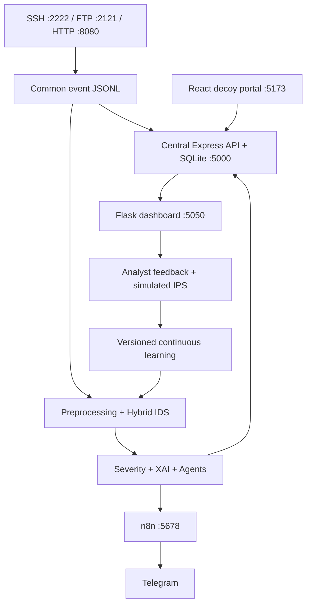

# A Secure and Intelligent Framework for Detecting and Understanding Malicious Digital Activities

This project is a Windows-based cybersecurity research prototype that combines multi-service honeypots, centralized event collection, a hybrid IDS [Intrusion Detection System], XAI [Explainable Artificial Intelligence], analyst feedback, simulated IPS [Intrusion Prevention System] actions, intelligent agents, continuous learning, dashboards, and Telegram alerts.

It is designed for authorized local demonstrations and academic research. It does not modify the Windows firewall, automatically block real hosts, or replace a production security platform.

## Current implementation

The complete roadmap is implemented through the final demonstration stage:

- SSH, FTP, and HTTP honeypots with one versioned event schema.
- SQLite-backed centralized events, IDS results, analyst feedback, and IPS audit records.
- Controlled scenarios for SSH brute force, FTP brute force, SQL injection, XSS, directory scanning, port scanning, and normal traffic.
- Sanitized dataset preparation, preprocessing, and causal feature engineering.
- Rule detection, Decision Tree, Random Forest, Isolation Forest, and LSTM models.
- Hybrid fusion, four-level threat reporting, SHAP-based supporting explanations, and human-readable reasons.
- An authenticated Flask analyst dashboard with filters, IDS/IPS, XAI, feedback, and simulated response actions.
- A separate attacker-facing React company portal with tracked decoy files and controlled SQLi/XSS data-exposure simulations.
- High/Critical enriched IDS alerts through n8n and Telegram.
- Six bounded intelligent agents for detection, correlation, severity, explanation, response recommendation, and daily reporting.
- Offline analyst-guided continuous learning with candidate versioning, quality gates, explicit promotion, and rollback.
- Automated offline and live end-to-end system verification.

## Architecture



### Live event flow

```text
Controlled activity
-> honeypot capture
-> common JSON event
-> sanitized preprocessing
-> rules + selected tabular model + Isolation Forest + LSTM
-> hybrid prediction and confidence
-> Low / Medium / High / Critical severity
-> SHAP support and human-readable explanation
-> six intelligent agents
-> JSONL and SQLite persistence
-> authenticated analyst dashboard and decoy portal response
-> High/Critical n8n and Telegram alert
-> analyst feedback and simulated response
```

## Services and ports

| Component | Port | Purpose |
|---|---:|---|
| SSH honeypot | 2222 | Captures repeated authentication attempts |
| FTP honeypot | 2121 | Captures logins, commands, and decoy-file activity |
| HTTP honeypot | 8080 | Captures login attacks, SQLi, XSS, and scanning |
| Flask dashboard | 5050 | Authenticated security operations dashboard |
| Express backend | 5000 | Authentication, APIs, SQLite persistence, feedback, and IPS audit |
| React frontend | 5173 | Attacker-facing company portal, decoy files, and safe SQLi/XSS demonstrations |
| n8n | 5678 | Alert workflow and Telegram delivery |

## Detection and model roles

| Component | Role |
|---|---|
| Rules | Deterministic SQLi, XSS, scanning, and repeated-login detection |
| Decision Tree | Interpretable known-attack classification baseline |
| Random Forest | Ensemble known-attack classification candidate |
| Isolation Forest | Label-free unusual-behaviour detection trained on normal rows |
| LSTM | Causal sequence classification for time-based activity such as brute force |
| Hybrid IDS | Fuses rules, tabular classification, anomaly detection, and sequences |
| SHAP | Reports supporting feature contributions for tree-model decisions |
| Human reasoning | Explains the final decision without exposing credentials or raw payloads |

CNN and LIME are not presented as implemented components because the available data and final architecture use LSTM and SHAP.

## Supported labels

```text
normal
ssh_bruteforce
ftp_bruteforce
sql_injection
xss
directory_scanning
port_scanning
other_anomaly
```

## Quick start

The tested Windows project path is:

```text
D:\honeypot_v2
```

Complete first-time installation is in `SETUP.md`. The short five-terminal startup sequence is in `howtostart.md`.

The most important alert command is:

```powershell
python .\simulation\n8n.py --mode local --source ids
```

`--source ids` is required for intelligent Telegram alerts because raw events do not contain final severity, confidence, XAI, agent, or IPS fields.

## Final validation

Run the offline test, backend test, and frontend production build together:

```powershell
cd D:\honeypot_v2
.\.venv\Scripts\Activate.ps1
python .\scripts\final_system_test.py
```

With all seven services already running, verify the live services:

```powershell
python .\scripts\final_system_test.py --runtime
```

In an authorized local lab, run every controlled scenario end to end:

```powershell
python .\scripts\final_system_test.py --runtime --simulate-attacks --n8n-check
```

The report is written to:

```text
data/reports/final_system_test.json
```

The n8n check confirms webhook acceptance. Telegram receipt must still be visually confirmed because the Telegram chat is outside the repository.

## Continuous learning

Continuous learning is offline and analyst-controlled. It never retrains inside the live IDS process.

Check the registry:

```powershell
python -m continuous_learning.pipeline status
```

Prepare a sanitized feedback-corrected dataset without training:

```powershell
python -m continuous_learning.pipeline prepare `
  --output-dir data\continuous_learning\preview_dataset
```

Build and evaluate a versioned candidate:

```powershell
python -m continuous_learning.pipeline retrain --epochs 20
```

The candidate is compared with the active evaluation using macro F1, macro recall, false-positive rate, and minimum test-row gates. Promotion is never automatic.

After stopping `run.py` and every process using the active model, promote only a candidate whose manifest says `decision: promote`:

```powershell
python -m continuous_learning.pipeline promote VERSION_ID `
  --confirm-services-stopped
```

Restore a retained model tree if required:

```powershell
python -m continuous_learning.pipeline rollback ROLLBACK_ID `
  --confirm-services-stopped
```

## Main directories

```text
core/                  honeypots, schema, logger, simulated IPS
dataset/               sanitization and labeling
preprocessing/         missing values, encoding, scaling, sequences
feature_engineering/   causal behavioural and security features
rule_based_detection/  deterministic IDS rules
machine_learning/      training, evaluation, hybrid and real-time IDS
XAI/                   SHAP support and human-readable explanations
intelligent_agents/    six ordered analysis/reporting agents
continuous_learning/   versioning, comparison, promotion and rollback
dashboard/             Flask monitoring dashboard
website/backend/       Express API and SQLite stores
website/frontend/      attacker-facing React/Vite decoy portal
simulation/            controlled attacks and n8n forwarder
scripts/               final verification and startup helpers
tests/                 Python integration and safety tests
```

Generated logs, databases, model artifacts, reports, credentials, `.venv`, `node_modules`, n8n state, and continuous-learning versions are intentionally ignored by Git.

## Safety and limitations

- Use only on localhost or an explicitly authorized isolated lab network.
- Submit only fake credentials and synthetic test data.
- Automatic host blocking is hard-disabled; all IPS behaviour is simulated or recommendation-only.
- Stop live model consumers before promotion or rollback.
- SHAP explains supporting tree-model contributions; it does not prove causation.
- Model metrics are dataset-specific and do not prove production generalization.
- The SSH honeypot is a controlled decoy protocol simulation, not a production OpenSSH server.
- Telegram and n8n credentials stay outside Git and must never appear in screenshots or exports.
- This is an academic prototype, not a production SOC [Security Operations Center] product.

## Demonstration

Use `FINAL_DEMO_GUIDE.md` for the exact presentation order, expected outputs, fallback plan, and honest completion statement.
