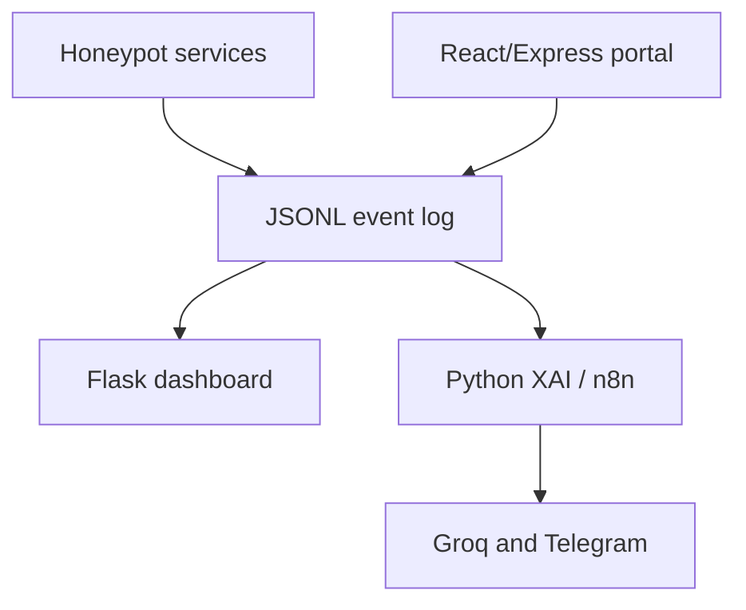

# majorproject

# sem7majorproject — Honeypot v2 Technical Handover Report

Analysis date: 12 July 2026
Source archive: `honeypot_v2.zip`

## Analysis coverage and limits

The original ZIP contains 5,378 entries: 751 directories and 4,627 files. Its compressed size is about 22.7 MB and its uncompressed content is about 62.8 MB. Every archive entry passed a CRC integrity check. No archive path traversal entry or symbolic-link entry was found.

All first-party source, configuration, documentation, workflow, template, static-asset, log, decoy-data, environment, database, and build-manifest files were reviewed and cross-referenced. The archive's files were also byte-scanned with no unreadable files. Python source was AST-parsed, JavaScript source passed syntax checks, the React application built successfully after a clean dependency install, Flask routes were smoke-tested, the SQLite database was inspected read-only, JSON/JSONL was parsed, and npm dependency audits were run on 12 July 2026.

The ZIP includes thousands of generated or third-party files:

* `website/backend/node_modules/`: 2,218 bundled files, with 237 packages represented by the lockfile.
* `website/frontend/node_modules/`: 2,322 bundled files, with 113 packages represented by the lockfile.
* `__pycache__/`: Python 3.11 bytecode caches.
* `website/frontend/dist/`: generated/minified frontend output.

Those generated/vendor files were inventoried and assessed through their manifests, lockfiles, hashes, native binaries, build output, and vulnerability audit; their thousands of third-party source lines were not manually reviewed one by one. The first-party source has no such exclusion.

## Executive conclusion

This is a useful security-lab prototype, but it is not yet a safe or coherent production application. The ZIP combines three partially overlapping application modes:

1. A Python SSH/FTP/HTTP honeypot stack with a Flask monitoring dashboard.
2. A standalone Flask decoy website.
3. An optional React + Express + SQLite decoy portal that writes into the same JSONL event stream.

The project also contains a rule-based Python module labelled XAI and two n8n alerting workflows. These parts are only partially integrated. The Python “XAI” module is not a trained ML model; it is deterministic aggregation and scoring. The n8n XAI path optionally calls Groq's hosted LLM, but its API authorization and Telegram destination are incomplete.

Before continuing features, the team should choose the canonical website architecture, rotate the exposed Telegram bot token, replace the shared JWT secret, remove captured runtime data from distributable archives, repair the known login/XAI bugs, protect the monitoring interfaces, and add tests.

# Phase 1 – Project overview

## Purpose

The application is a modular honeypot lab intended to attract and record suspicious activity against fake SSH, FTP, HTTP, and employee-portal services. Events are stored as JSON Lines, displayed in a monitoring dashboard, optionally analyzed with heuristic “XAI” logic, and optionally forwarded to n8n for Groq/Telegram reporting.

## Implemented features

* Raw TCP service that resembles an SSH login prompt and records credentials.
* Real FTP server using `pyftpdlib`, with bait files and weak/anonymous logins.
* Flask HTTP honeypot that detects simple SQL injection, XSS, directory scanning, and brute-force patterns.
* Central JSONL logger and an in-memory Server-Sent Events queue.
* Flask dashboard with statistics, recent events, captured credentials, reports, and an SSE live feed.
* Separate Flask decoy employee portal and bait-file downloads.
* Alternate React employee portal backed by Express, JWT authentication, bcrypt, and SQLite.
* SSH/FTP/HTTP traffic simulation scripts.
* n8n webhook workflows for filtering, formatting, Groq analysis, and Telegram notifications.
* Python rule-based attacker profiling and report generation.
* Optional Cloudflare Tunnel PowerShell helper.

## Overall architecture



The SQLite database is used only by the Express portal's user authentication. Honeypot telemetry is not stored in SQLite; it is appended to `data/raw_logs/honeypot_events.jsonl`.

## Technology stack

| Area               | Technology                                                  |
| ------------------ | ----------------------------------------------------------- |
| Core services      | Python, `socketserver`, Flask, `pyftpdlib`                  |
| Logging            | JSON Lines, Python queue and locks, Node filesystem appends |
| Dashboard          | Flask, Jinja/HTML/CSS/JavaScript, SSE, optional `psutil`    |
| Alternate frontend | React 18, React Router 6, Vite 5                            |
| Alternate backend  | Node.js, Express 4, SQLite, JWT, bcryptjs, CORS, dotenv     |
| Database           | SQLite file `website/backend/data/honeypot.db`              |
| Automation         | n8n workflow JSON                                           |
| Hosted AI          | Groq chat-completions API through n8n                       |
| Tunnel             | Cloudflare `cloudflared` PowerShell automation              |
| Package tools      | `pip`, npm lockfile v3                                      |
| ML models          | None in the ZIP                                             |

## Folder structure

```text
honeypot_v2/
├── config/                 Intended YAML configuration; currently not loaded
├── core/                   Logger, launcher, SSH/FTP/HTTP honeypots
├── dashboard/              Flask monitoring UI and APIs
├── data/                   FTP bait files and JSONL telemetry
├── n8n/                    Two exported n8n workflows
├── scripts/                Cloudflare Tunnel PowerShell helper
├── simulation/             Attack generators and alternate n8n forwarder
├── website/                Flask site plus optional React/Express stack
├── XAI/                    Rule-based analyzer and webhook report sender
├── run.py                  Python full-stack launcher
├── run_website.py          Standalone Flask decoy-site launcher
├── requirements.txt        Python runtime dependencies
└── README.md               Primary documentation
```

# Phase 2 – Deep analysis

## `core/`

### `core/logger.py`

This is the central Python telemetry component. `log_event()` creates the common event schema, serializes one JSON object per line, places the event on an in-memory queue, and starts a background webhook thread for each critical event. `read_recent_events()` reads the entire log file and returns the newest requested records in reverse order. `_build_n8n_payload()` normalizes an event for n8n.

Important relationships:

* All three Python honeypots and the standalone Flask website call `log_event()`.
* The dashboard imports `read_recent_events()` and `get_stream_queue()`.
* Critical events are POSTed to `/webhook/honeypot-alert` by default.

Important problems:

* The queue size is hardcoded to 500 while `config.yaml` says 500,000.
* A queue is not a broadcast mechanism: multiple SSE clients compete for events instead of each receiving every event.
* `read_recent_events()` loads the full growing log on every API request.
* A new thread is created for every critical webhook, allowing thread exhaustion during a burst.
* Passwords, cookies, authorization headers, and full payloads can be forwarded and retained in plaintext.
* Webhook failure is silently discarded.

### `core/launcher.py`

`start_all()` imports and launches SSH, FTP, and HTTP services in daemon threads. It returns the threads, but `run.py` does not monitor them for failure or expose graceful shutdown hooks.

### `core/honeypots/ssh_honeypot.py`

This is not a complete SSH protocol server. It is a raw TCP prompt that emits an OpenSSH-looking banner, asks for username/password lines, always denies access, and logs the pair. The simulation works because it also uses a raw socket; a normal SSH client expects key exchange and will not operate like the simulation.

The per-IP counter has no time window, expiry, or size limit. After three lifetime attempts, every later attempt from that IP is marked brute force. The YAML threshold of five is ignored.

### `core/honeypots/ftp_honeypot.py`

This uses `pyftpdlib` and therefore behaves as a real FTP service. It creates/serves bait files, permits anonymous access, and defines `admin/admin`, `root/root`, and `ftp/ftp`. All accounts, including anonymous, receive broad read/write/delete/modify permissions.

This is dangerous outside an isolated lab: an untrusted user can upload or alter files and consume disk space. The failed-login dictionary also has no expiry. File retrieval is logged only as a generic `ftp_command`; no `ftp_file_download` event is emitted even though XAI expects that name.

### `core/honeypots/http_honeypot.py`

The Flask application has `/`, `/login`, `/search`, `/admin`, `/upload`, `/forgot`, and a catch-all. Regexes identify a limited set of SQLi, XSS, and path-scanning strings. Login history is tracked in memory for a 60-second/10-attempt threshold.

The code trusts `X-Forwarded-For` without a trusted-proxy policy. An attacker can spoof many IPs and grow `_login_history`. Windows-style traversal (`..\`) and many encoded/obfuscated payloads are not detected. The upload route deliberately does not save uploaded files.

## `dashboard/`

### `dashboard/app.py`

This Flask app reads the JSONL file and exposes monitoring/report APIs. It calculates totals, service/attack/severity distributions, top IPs, a timeline, system statistics, captured credentials, and basic “XAI alert” subsets. It can POST a batch to a hardcoded n8n endpoint.

There is no authentication or authorization. It binds to `127.0.0.1` by default, but any tunnel, reverse proxy, or host change would expose credentials and reports. The webhook URL is hardcoded rather than configured. The report endpoint includes plaintext captured passwords.

### `dashboard/templates/index.html`

Single-page dashboard UI using plain JavaScript. It calls `/api/*`, opens `/stream` with `EventSource`, and uses external Google Fonts and Feather Icons. Most attacker-controlled strings pass through `esc()`, but some values are placed into `innerHTML` without complete escaping. Today service/severity values are mostly server-controlled, but log tampering or future integrations could create stored XSS. No Content Security Policy or Subresource Integrity is used.

## `website/`

### `website/app.py` and `website/templates/index.html`

This is the standalone Flask decoy portal. It logs index visits, login attempts, search payloads, file access, and unknown paths. Jinja auto-escaping is used. The file route checks a constructed path and then delegates to Flask's safe `send_from_directory`; the tested `../backend/.env` traversal returned 404.

`run_website.py` defaults to `0.0.0.0`, making the site reachable from the LAN. Use `--host 127.0.0.1` for development.

### `website/frontend/`

* `src/main.jsx`: React root and `BrowserRouter`.
* `src/App.jsx`: routes `/`, `/signup`, `/dashboard`; a token-presence-only protected route; route logging.
* `src/api.js`: API wrapper and frontend telemetry. Both the API base and n8n URL are hardcoded localhost URLs.
* `HomePage.jsx`: login, search, bait-file list/download.
* `SignUpPage.jsx`: public registration.
* `DashboardPage.jsx`: protected summary, backend-log alerts, and direct browser-to-n8n Groq/Telegram trigger.
* `PortalShell.jsx`: shared page wrapper.
* `styles.css`: responsive dark UI.
* `dist/`: generated output; a clean build produced different asset hashes/sizes, so the included build is stale.

State is local component state only; there is no global state library. JWT and user data are stored in `localStorage`. This is simple but exposes the token to any successful XSS. API URLs will fail when accessed from another computer or deployed because `localhost` means the visitor's own machine.

### `website/backend/`

* `server.js`: Express routes, auth flow, logging, attack regexes, file service, and server startup.
* `db.js`: opens SQLite and creates the `users` table.
* `middleware/auth.js`: verifies a bearer JWT.
* `.env.example`: `PORT`, `JWT_SECRET`, `FRONTEND_URL`.
* `.env`: contains set values and was included in the ZIP; treat its JWT secret as compromised.
* `logs/`: runtime logs containing request/auth material.
* `data/honeypot.db`: one user record exists.

Critical functional bug: the invalid-login branch in `server.js` references an undefined variable named `email`. A failed login can throw inside the asynchronous callback instead of returning the intended 401 response.

`sanitizeBody()` returns the body unchanged. The global request middleware therefore logs signup/login passwords and protected-route bearer tokens. Open signup plus “any authenticated user can access logs” means an attacker can create an account and read sensitive backend/frontend logs. There is no role or admin check.

Queries use SQLite placeholders, so the current user queries are not SQL-injection vulnerable. The `/files/:filename` route uses `path.join()` without proving the result remains inside the decoy directory. Encoded separators and Windows path behavior make this a potential traversal issue; use `path.resolve()` plus a containment check.

## `XAI/`

### `attack_analyzer.py`

Defines `AttackSignature`, `AttackerProfile`, and `AttackAnalyzer`. It aggregates events by IP, maps some attack types to MITRE labels, creates heuristic risk scores, tracks payloads, and exports dataclasses.

Confirmed bug: `_update_behavioral_patterns()` checks whether the string `behavioral_patterns` is a key inside the behavioral-pattern dictionary. It never is, so the dictionary resets on every event. Two reconnaissance events produce a count of one, not two.

Other limitations:

* Python's process-randomized `hash()` is used as if it were a stable payload hash.
* SSH usernames in payload dictionaries are not extracted because credentials are checked only in metadata.
* `CRITICAL_EVENTS`, `geographic_info`, and signature `indicators` are unused.
* Persistence attempts are never incremented.
* Any event name containing `file` can be classified as data exfiltration.
* This is rule-based analytics, not explainable ML.

### `merger.py`

Loads the entire JSONL file, processes all events in memory, builds a report, optionally writes it, and sends it with `requests` retry support.

Confirmed packaging bug: it imports `attack_analyzer` as a top-level module. `python XAI/merger.py ...` works, but the documented `from XAI.merger import XAIMerger` fails. The import should be package-relative with a direct-script fallback.

The CLI dry run succeeds on the included 461-event log and profiles five source identifiers. It emits a Python 3.12 deprecation warning for `datetime.utcnow()`. Documentation references `xai_report_example.json`, but that file is absent. Documentation claims GB-scale suitability even though all events and timelines are retained in memory.

## `n8n/`

### `alert_sender.json`

Active exported workflow: webhook `honeypot-alert` → severity filter → per-IP five-minute dedupe → message formatter → two Telegram HTTP requests.

Problems:

* A Telegram bot token is hardcoded in two request URLs. Rotate/revoke it immediately.
* One Telegram request has an empty chat ID; the other contains a fixed chat identifier.
* Both requests are connected and can cause one failure plus one send/duplicate behavior.
* The message says `CRTICAL` even for warning events.
* Global in-process dedupe is not reliable across n8n restarts/workers and suppresses all attack types from the same IP.

### `xai_node.json`

Active exported workflow: webhook `xai-honeypot` → normalize single event → rule-based score → Groq API → set report field → Telegram node.

The Groq `Authorization` value is empty, the Telegram `chatId` is empty, and the formatter names a field `=reportt` while Telegram reads `reportt`; this is likely broken. A Telegram credential reference exists, but exported workflows do not contain the actual secret.

### Integration mismatch

* Python `XAI/merger.py` documentation sends full reports to `/webhook/xai-report`, but no ZIP workflow listens there.
* Python dashboard sends a batch object to `/webhook/xai-honeypot`, while that workflow expects a single event.
* React dashboard sends one event to `/webhook/xai-honeypot`, which is closer to the workflow's expected shape.
* `simulation/honeypot-alert.workflow.json` uses the same `honeypot-alert` path as `alert_sender.json`; do not activate both with the same production webhook path.

## `simulation/`

* `simulate_attacks.py`: runs SSH and FTP in parallel, then HTTP.
* `sim_ssh.py`: 16 raw TCP credential attempts.
* `sim_ftp.py`: only one `ftp/ftp` credential attempt despite being described as brute force.
* `sim_http.py`: brute force, SQLi, XSS, and directory scan payloads.
* `n8n.py`: tails the JSONL log and forwards normalized records, duplicating normalization/webhook logic from `core/logger.py`.
* `_n8n_test_events.jsonl`: one normalized test event.
* `honeypot-alert.workflow.json`: inactive two-node normalize-only n8n workflow.

## Configuration, data, and generated files

* `config/config.yaml` is never loaded. All important values are duplicated in code/CLI defaults.
* The YAML SSH threshold is five, actual code uses three.
* `data/raw_logs/honeypot_events.jsonl`: 461 valid records; 68 records include credential/auth-related fields.
* `data/raw_logs/old.jsonl`: 416 valid records; 128 include credential/auth-related fields.
* Backend logs: 87 valid JSON records total, including request/auth data.
* `honeypot.db`: valid SQLite database, one `users` row, no relations.
* `temp.html`: unused earlier dashboard variant/dead artifact.
* Both `node_modules` directories contain Windows-native binaries and must not be trusted or reused as project source.
* Root `.gitignore` ignores `*.json`, all `n8n/`, `.env.*`, logs, DBs, and builds. This can accidentally ignore `package.json`, lockfiles, workflows, and `.env.example` unless already tracked. The ignore rules need correction.

# Phase 3 – Execution flow

## Mode A: Full Python honeypot stack

1. `python run.py` parses port options.
2. `core.launcher.start_all()` creates daemon threads for SSH, FTP, and HTTP.
3. SSH binds `0.0.0.0:2222`, FTP binds `0.0.0.0:2121`, and HTTP binds `0.0.0.0:8080`.
4. Unless `--no-dashboard` is used, a dashboard thread binds `127.0.0.1:5050`.
5. A request/connection reaches a honeypot handler.
6. The handler classifies the activity and calls `core.logger.log_event()`.
7. The event is appended to JSONL and queued for SSE.
8. If severity is critical, a background thread POSTs it to n8n.
9. The browser dashboard calls `/api/monitor`, then opens `/stream`.
10. Optional `--simulate` starts safe local traffic after startup.

## Mode B: Standalone Flask decoy website

1. `python run_website.py --host ... --port ...` imports `website.app`.
2. Flask renders the employee portal and lists `website/decoy_files`.
3. Login/search/file/unknown-path actions are regex-classified.
4. Events use the same central JSONL logger, so the Python dashboard can show them.

## Mode C: React + Express + SQLite portal

1. `npm run dev` in `website/backend` loads `.env`, opens SQLite, creates `users`, and starts port 5000.
2. `npm run dev` in `website/frontend` starts Vite on port 5173.
3. React requests `/files` and logs route visits to `/frontend/log`.
4. Signup hashes the password with bcrypt cost 10 and inserts the user.
5. Login fetches the user by parameterized username, compares the hash, and signs an eight-hour JWT.
6. React stores JWT/user in `localStorage` and requests `/dashboard` with `Authorization: Bearer ...`.
7. Express logs both internal logs and normalized records into the shared Python JSONL file.
8. An optional separately started Python dashboard reads those records.
9. The React XAI button sends one selected alert directly from the browser to n8n.

# Phase 4 – Database

## Schema

```sql
CREATE TABLE users (
  id INTEGER PRIMARY KEY AUTOINCREMENT,
  username TEXT UNIQUE NOT NULL,
  email TEXT UNIQUE NOT NULL,
  password_hash TEXT NOT NULL,
  created_at DATETIME DEFAULT CURRENT_TIMESTAMP
);
```

SQLite creates unique indexes for username and email. There are no foreign keys, relations, migrations, roles, sessions, refresh tokens, audit tables, or seed scripts. Database integrity is valid. Foreign-key enforcement is off, but there are no foreign keys to enforce.

## Queries and data flow

* Startup: `CREATE TABLE IF NOT EXISTS users`.
* Signup: parameterized `INSERT` of trimmed username, lowercase email, and bcrypt hash.
* Login: parameterized `SELECT` by trimmed username.
* The returned user ID/username/email become JWT claims.

The ZIP database contains one existing user record. Do not treat it as seed data unless your teammate confirms it. Back it up outside the repo, then let `db.js` create a clean database.

# Phase 5 – APIs

## Python HTTP honeypot (`:8080`)

| Endpoint           | Request and behavior                                                 | Response                 | Protection/validation                 |
| ------------------ | -------------------------------------------------------------------- | ------------------------ | ------------------------------------- |
| `GET /`            | Logs visit                                                           | HTML portal              | None                                  |
| `GET/POST /login`  | POST reads form username/password, tracks attempts, detects patterns | HTML login, always fails | No CSRF; intentional honeypot         |
| `GET /search?q=`   | Detects query patterns                                               | JSON empty results       | No length limit                       |
| `GET /admin`       | Logs probe                                                           | JSON 403                 | None                                  |
| `GET/POST /upload` | Logs filename/body preview; does not save                            | JSON                     | Body handled by Flask limits/defaults |
| `GET /forgot`      | Logs visit                                                           | Fake JSON message        | None                                  |
| `GET/POST /<path>` | Detects scans                                                        | JSON 404                 | None                                  |

## Standalone Flask website (`:8090`)

| Endpoint            | Behavior                       | Response           |
| ------------------- | ------------------------------ | ------------------ |
| `GET /`             | Logs and lists bait files      | HTML               |
| `POST /login`       | Logs form credentials/patterns | HTML failed login  |
| `GET /search?q=`    | Logs/detects query             | JSON empty results |
| `GET /files/<path>` | Logs and serves a bait file    | File or 404        |
| `GET/POST /<path>`  | Logs unknown paths             | 404                |

## Python dashboard (`:5050`)

All endpoints are unauthenticated.

| Endpoint                   | Response                                                       |
| -------------------------- | -------------------------------------------------------------- |
| `GET /`                    | Dashboard HTML                                                 |
| `GET /api/monitor`         | Totals, system stats, latest 15 events                         |
| `GET /api/honeypot`        | Per-service statistics/recent events and up to 100 credentials |
| `GET /api/credentials`     | Extracted credential list                                      |
| `GET /api/ids`             | Stats, 24-bucket timeline, top 10 IPs                          |
| `GET /api/xai/alerts`      | Up to 50 warning/critical events                               |
| `POST /api/xai/report`     | Sends up to 30 alerts to hardcoded n8n webhook                 |
| `GET /api/report`          | Summary, all extracted credentials in window, recent threats   |
| `GET /api/report/download` | Plaintext downloadable threat report                           |
| `GET /stream`              | SSE event stream and 15-second heartbeat                       |

## Express backend (`:5000`)

| Endpoint                    | Request                   | Response               | Auth/validation/issues                                |
| --------------------------- | ------------------------- | ---------------------- | ----------------------------------------------------- |
| `GET /`                     | None                      | Service info/routes    | Public                                                |
| `POST /frontend/log`        | JSON event/details/path   | 202                    | Public; can be spammed/log-injected                   |
| `POST /signup`              | username, email, password | 201/400/409            | Public; presence only, no role/length/email policy    |
| `POST /login`               | username, password        | JWT/user or 401        | Failed branch currently crashes due undefined `email` |
| `GET /dashboard`            | Bearer JWT                | Random KPIs and claims | Any registered user                                   |
| `GET /search?q=`            | Query                     | Empty results          | Public                                                |
| `GET /files`                | None                      | Bait filenames         | Public                                                |
| `GET /files/:filename`      | Filename                  | File/404               | Potential path-containment flaw                       |
| `GET /logs/backend?limit=`  | Bearer JWT                | Last 1–500 entries     | Any registered user can read sensitive logs           |
| `GET /logs/frontend?limit=` | Bearer JWT                | Last 1–500 entries     | Same issue                                            |
| fallback                    | Any unknown route         | JSON 404               | Logged                                                |

# Phase 6 – Frontend

The React frontend uses three routes and local component state. It has no Redux/Context/query cache. Navigation flow is home → signup or login → dashboard → logout. Authentication state is only the presence of `hp_token` in local storage; the backend performs real token verification on API calls.

React safely escapes ordinary rendered strings, and no `dangerouslySetInnerHTML` is used. The main risks are token storage, hardcoded localhost addresses, direct browser-to-n8n traffic, no centralized 401 redirect, stale bundled `dist`, and absent production configuration.

The Flask dashboard is a separate frontend, not a React page. Its API contract is unrelated to the Express `/dashboard` endpoint despite the identical word “dashboard.”

# Phase 7 – Backend

There are two backends:

* Python: honeypot protocols, JSONL logging, monitoring APIs, standalone decoy site.
* Node: optional employee portal, user database/JWT, and duplicate telemetry writing.

Neither uses a service/controller/repository architecture. Route handlers contain validation, business logic, logging, and persistence directly. Error handling is mostly local `try/except` or callback checks; there is no shared error middleware, typed schema validation, or structured operational logging policy.

Recommended target architecture:

* One configuration module.
* One canonical portal implementation.
* Event schema validator and append-only telemetry service.
* Auth service plus role/permission middleware.
* Database repository and migrations.
* Analysis service separated from webhook delivery.
* Tests around each boundary.

# Phase 8 – Security review

## Critical/high findings

1. **Exposed Telegram bot token** — hardcoded in `n8n/alert_sender.json`. Revoke/rotate now and remove it from archives and Git history.
2. **Shared JWT secret in ZIP** — `website/backend/.env` contains a set secret. Generate a new one; never distribute `.env`.
3. **Sensitive runtime data shipped** — database has one user; logs contain credential/auth material; raw logs have many credential-bearing records.
4. **Open registration becomes log access** — anyone can sign up, log in, then access `/logs/backend` and `/logs/frontend` because no admin role exists.
5. **Passwords and bearer tokens logged** — `sanitizeBody()` does nothing and request headers include authorization/cookies.
6. **Unauthenticated Python dashboard** — exposes captured credentials and can trigger outbound n8n reports.
7. **FTP is writable and exposed on all interfaces** — weak/anonymous accounts have broad permissions.
8. **Potential Express file traversal** — no resolved-path containment check.
9. **Dependency vulnerabilities** — current npm audit reports 16 backend findings (5 high, 9 moderate, 2 low) and 10 frontend findings (1 high, 5 moderate, 4 low). Not all are runtime-reachable, but Vite, Express-chain, sqlite build-chain, tar, and router findings require an upgrade plan.

## Medium findings

* No rate limits on signup/login/frontend logging; honeypot trackers can grow indefinitely.
* Trust of spoofable `X-Forwarded-For` without proxy configuration.
* JWT fallback `dev_secret`; no required startup validation, issuer, audience, or explicit algorithm.
* Local-storage JWT exposure if XSS occurs.
* Cross-process writes to the same JSONL file have no shared lock.
* Synchronous full-log reads block Flask requests/Node event loop and enable memory/CPU denial of service.
* External CDN scripts/styles lack CSP/SRI and make the dashboard internet-dependent.
* Direct browser call to n8n exposes the webhook and can fail through CORS/deployment addressing.
* Webhook data can include credentials, headers, cookies, and tokens sent to third parties.
* No retention, rotation, access-control, encryption-at-rest, or redaction policy for logs.
* n8n workflows contain fixed identifiers and incomplete credential configuration.
* Cloudflare exposure is possible before authentication/security controls are repaired.

## SQL injection, XSS, and CSRF summary

* SQL injection: current SQLite queries are parameterized. Search is not connected to SQL. Regex detection is not prevention and is easily bypassed, but no current dynamic query was found.
* XSS: React/Jinja ordinary output is escaped. Flask dashboard uses `innerHTML`; most high-risk strings are escaped, but harden by using DOM `textContent` and a CSP.
* CSRF: Bearer tokens in an Authorization header reduce classic cookie-CSRF risk in Express. Flask dashboard's state-changing n8n POST has no auth/CSRF. Honeypot login forms intentionally accept arbitrary submissions.

## Safe operating boundary

Run this only in a VM or isolated lab network until the critical findings are fixed. Do not place it on a university/company network without written permission. Never expose the Python monitoring dashboard, raw log directory, SQLite database, or n8n editor publicly.

# Phase 9 – Code quality

## Strengths

* Clear first-party folder names and readable Python type hints.
* Shared Python event schema and central logger.
* Parameterized SQL and bcrypt password hashes.
* Flask app factories support testing.
* React components are small and straightforward.
* Simulation scripts make demonstrations reproducible.
* JSONL is simple for a prototype and XAI dry runs.

## Maintainability/scalability concerns

* `config.yaml` is dead while values are duplicated across many files.
* Three website implementations create unclear ownership and duplicated attack detection.
* Webhook normalization is duplicated in Python and n8n-forwarder code.
* Route files mix controller, service, repository, validation, and logging concerns.
* No automated tests, lint config, CI, container, migration system, or deployment manifest.
* Python dependency ranges are not locked; installs are not reproducible.
* Generated dependencies/caches/builds/runtime data are in the ZIP.
* JSONL full-file reads and unbounded growth will degrade with time.
* Random Express dashboard KPIs are not connected to actual telemetry.
* Error callbacks often ignore filesystem/webhook errors.

## Refactoring priorities

1. Decide one canonical portal and remove/archive the other implementation.
2. Load one typed config source and eliminate hardcoded URLs/ports/thresholds.
3. Define/version a single event JSON schema.
4. Redact secrets at ingestion and separate attacker bait credentials from legitimate user credentials.
5. Move telemetry to SQLite/PostgreSQL or implement indexed rotation/tailing.
6. Add controllers/services/repositories and role-based authorization.
7. Repair XAI packaging/counters and define a single n8n contract.
8. Add pytest, API integration tests, React tests, and CI security audits.

# Phase 10 – Missing or incomplete features

* No real IDS or ML model; roadmap dependencies are commented out.
* Python XAI is heuristic and has confirmed aggregation/import bugs.
* No compatible `/xai-report` n8n workflow for `XAI/merger.py`.
* Groq authorization and Telegram destination are incomplete.
* No admin/role model for monitoring logs.
* No password policy, account verification, reset, refresh token, or session revocation.
* No configuration loading despite YAML.
* No test suite; the only “test” file is one JSONL event.
* No Python lockfile, Docker, CI/CD, deployment configuration, or health/readiness checks.
* No database migrations or sanitized seed data.
* No log rotation/retention/redaction.
* No graceful service shutdown/restart/health monitoring.
* No real SSH protocol implementation.
* No file-upload storage (intentionally fake), and no explicit FTP download event.
* `xai_report_example.json` and a project `LICENSE` referenced/implied by docs are absent.
* Included React `dist` is stale.
* Cloudflare named-tunnel script assumes a credential filename based on tunnel name; Cloudflare normally creates a credentials file keyed by tunnel UUID, so named mode needs verification/fix.

# Phase 11 – Local setup and development guide

## 1. Software requirements

Recommended laptop setup for this ZIP:

| Software      | Recommendation                                               | Required for                                     |
| ------------- | ------------------------------------------------------------ | ------------------------------------------------ |
| OS            | Windows 10/11 64-bit                                         | Matches PowerShell script and bundled provenance |
| IDE           | VS Code current stable                                       | Recommended, not mandatory                       |
| Python        | Python 3.12 x64; 3.11 also compatible                        | Python honeypots/dashboard/XAI                   |
| Node.js       | Node 22.22+ LTS x64                                          | React, Express, and current n8n range            |
| npm           | Bundled with Node                                            | JS dependencies/n8n                              |
| Git           | Current Git for Windows                                      | Team workflow/history                            |
| SQLite server | Not required                                                 | SQLite is embedded through npm package           |
| Java/JDK      | Not required                                                 | No Java code/build exists                        |
| n8n           | Optional for core run; required for Telegram/Groq automation | Webhook workflows                                |
| cloudflared   | Optional                                                     | Public tunnel only                               |

Official downloads:

* [Python for Windows](https://www.python.org/downloads/windows/)
* [Node.js downloads](https://nodejs.org/en/download)
* [VS Code](https://code.visualstudio.com/download)
* [Git for Windows](https://git-scm.com/install/windows)
* [n8n npm installation](https://docs.n8n.io/deploy/host-n8n/install-options/install-with-npm/)
* [cloudflared downloads](https://developers.cloudflare.com/cloudflare-one/networks/connectors/cloudflare-tunnel/downloads/)

n8n currently supports Node 20.19 through 24.x. Node 22 LTS is the best common version for this project and n8n.

## 2. First-time installation and safe preparation

Open PowerShell:

```powershell
New-Item -ItemType Directory -Force C:\Projects\sem7majorproject
Expand-Archive "$HOME\Downloads\honeypot_v2.zip" -DestinationPath C:\Projects\sem7majorproject
Set-Location C:\Projects\sem7majorproject\honeypot_v2
code .
```

Before running:

1. Ask your teammate to revoke the Telegram token in the ZIP. Use Telegram's [BotFather guide](https://core.telegram.org/bots/tutorial) for a replacement.
2. Do not reuse `website/backend/.env`; create a new JWT secret.
3. Back up the included database/logs only if they are needed as evidence. Otherwise start with clean runtime files.
4. Delete both bundled `node_modules` folders. They are generated, Windows-specific, non-portable, and potentially unsafe to trust:

```powershell
Remove-Item -Recurse -Force .\website\backend\node_modules
Remove-Item -Recurse -Force .\website\frontend\node_modules
```

5. Do not commit `.env`, databases, logs, `node_modules`, `dist`, or `__pycache__`.

## 3. Python dependencies

From the project root:

```powershell
py -3.12 -m venv .venv
Set-ExecutionPolicy -ExecutionPolicy RemoteSigned -Scope Process
.\.venv\Scripts\Activate.ps1
python -m pip install --upgrade pip
python -m pip install -r requirements.txt -r XAI\requirements.txt
python -m pip install psutil
```

The last package is optional but enables real CPU/RAM/network statistics in the dashboard.

Verify:

```powershell
python --version
python -c "import flask, pyftpdlib, yaml, requests; print('Python dependencies OK')"
```

## 4. Node dependencies

Backend:

```powershell
Set-Location .\website\backend
npm.cmd ci
Copy-Item .env.example .env -Force
```

Frontend in a second terminal:

```powershell
Set-Location C:\Projects\sem7majorproject\honeypot_v2\website\frontend
npm.cmd ci
```

`npm ci` uses the exact lockfile and recreates `node_modules`. Using `npm.cmd` avoids the common PowerShell `npm.ps1 cannot be loaded` error.

## 5. Environment variables

### Express `.env`

Create `website/backend/.env` with:

```dotenv
PORT=5000
JWT_SECRET=replace_with_a_new_random_secret
FRONTEND_URL=http://localhost:5173
```

Generate a secret:

```powershell
node -e "console.log(require('crypto').randomBytes(48).toString('hex'))"
```

Paste its output as `JWT_SECRET`. Never send it in chat or commit it.

### Python process variables

Optional in the PowerShell session that starts Python:

```powershell
$env:N8N_WEBHOOK_URL = "http://localhost:5678/webhook/honeypot-alert"
$env:N8N_WEBHOOK_TIMEOUT = "2.0"
```

Set `N8N_WEBHOOK_URL` to an empty string to disable automatic critical-event forwarding:

```powershell
$env:N8N_WEBHOOK_URL = ""
```

### Missing frontend variables

The frontend currently has no environment-variable support. `src/api.js`, `HomePage.jsx`, and `DashboardPage.jsx` hardcode ports 5000 and 5678. A future fix should use `VITE_API_BASE_URL` and a backend proxy for n8n; do not put Groq/Telegram secrets into `VITE_*` variables because Vite exposes them to the browser.

### n8n credentials

You need:

* A newly rotated Telegram bot token and destination chat ID.
* A Groq API key from [Groq API Keys](https://console.groq.com/keys).
* n8n credentials/nodes configured without hardcoding secrets. Groq explicitly recommends environment variables or a secret manager rather than source-code secrets.

## 6. Database setup

No database server or SQL import is needed. `db.js` creates the SQLite file/table automatically.

For a clean database, first preserve the teammate's file:

```powershell
Set-Location C:\Projects\sem7majorproject\honeypot_v2\website\backend\data
Rename-Item honeypot.db honeypot.teammate-backup.db
```

Starting the backend creates a new `honeypot.db`. There is no official seed script. Create your first user through the React signup page or `POST /signup`.

## 7. Running the project

### Recommended first verification: Python-only mode

From the root with the venv active:

```powershell
python run.py
```

Open:

* Dashboard: `http://127.0.0.1:5050`
* Fake HTTP portal: `http://127.0.0.1:8080`
* FTP: port `2121`
* Raw SSH-like TCP service: port `2222`

The three honeypots bind all network interfaces. For the first run, use an isolated/private network or VM and block inbound access in Windows Firewall. The code needs a host option/config integration before it is safe for ordinary public-network development.

Run simulations in a second venv-activated terminal:

```powershell
python simulation\simulate_attacks.py --http-only
python simulation\simulate_attacks.py --ssh-only
python simulation\simulate_attacks.py --ftp-only
```

### Standalone Flask decoy site

Do not run this on the same port as another site:

```powershell
python run_website.py --host 127.0.0.1 --port 8090
```

Open `http://127.0.0.1:8090`.

### React/Express development mode

Terminal 1 — backend:

```powershell
Set-Location C:\Projects\sem7majorproject\honeypot_v2\website\backend
npm.cmd run dev
```

Terminal 2 — frontend:

```powershell
Set-Location C:\Projects\sem7majorproject\honeypot_v2\website\frontend
npm.cmd run dev
```

Open `http://localhost:5173`. Backend health is `http://localhost:5000`.

Terminal 3 — optional Python monitoring dashboard for events generated by Express:

```powershell
Set-Location C:\Projects\sem7majorproject\honeypot_v2
.\.venv\Scripts\Activate.ps1
python dashboard\app.py
```

### n8n

Install/start:

```powershell
npm.cmd install n8n -g
n8n.cmd
```

Open `http://localhost:5678`. Import workflow JSON through the n8n UI, but do not activate it until the leaked token is rotated and credentials/chat IDs are repaired. Import only one workflow for `honeypot-alert`; duplicate webhook paths conflict conceptually.

The included `/xai-report` documentation cannot work end to end because its matching workflow is missing. `python XAI\merger.py ... --dry-run` works locally, but sending requires a compatible teammate-provided workflow.

## 8. Common errors and fixes

| Error                                           | Cause/fix                                                                                                                   |
| ----------------------------------------------- | --------------------------------------------------------------------------------------------------------------------------- |
| `npm.ps1 cannot be loaded`                      | Use `npm.cmd ...` or set execution policy for the current process.                                                          |
| `invalid ELF header`/native module error        | Bundled Windows `node_modules` used on another OS. Delete and run `npm ci`.                                                 |
| `sqlite3` install/node-gyp failure              | Use Node 22 x64, clean `node_modules`/npm cache, retry. If it compiles, install Visual Studio Build Tools with Desktop C++. |
| `ModuleNotFoundError`                           | Activate `.venv`, then install both requirements files.                                                                     |
| Port already in use                             | `Get-NetTCPConnection -LocalPort 5000` (change number as needed), stop process or change port.                              |
| Frontend CORS/network error                     | Ensure backend is on 5000 and `.env` `FRONTEND_URL` exactly matches 5173 origin.                                            |
| Invalid login hangs/crashes                     | Known undefined-`email` bug in `server.js`; fix before testing failed logins.                                               |
| `from XAI.merger import ...` fails              | Known absolute-import bug; direct CLI works until repaired.                                                                 |
| n8n connection refused                          | Start n8n and activate the matching production webhook workflow.                                                            |
| Groq 401                                        | Configure a new API key in n8n Authorization credential/header.                                                             |
| Telegram send fails                             | Rotate token, set chat ID, remove duplicate request node, activate workflow.                                                |
| React works locally but not on phone/deploy     | Hardcoded `localhost` URLs must be replaced with environment/configured API URLs.                                           |
| Dashboard fonts/icons missing                   | External CDNs require internet; vendor assets locally for offline use.                                                      |
| Cloudflare named tunnel cannot find credentials | Script likely uses tunnel name instead of UUID credential filename; repair config generation.                               |

## 9. Verify setup

Python ports:

```powershell
Test-NetConnection 127.0.0.1 -Port 5050
Test-NetConnection 127.0.0.1 -Port 8080
Test-NetConnection 127.0.0.1 -Port 2121
Test-NetConnection 127.0.0.1 -Port 2222
Invoke-RestMethod http://127.0.0.1:5050/api/monitor
```

React/Express:

```powershell
Invoke-RestMethod http://localhost:5000/
Invoke-RestMethod http://localhost:5000/files
```

Then:

1. Create a test account in the React UI.
2. Log in with the valid account.
3. Confirm `website/backend/data/honeypot.db` exists.
4. Trigger a safe search payload.
5. Confirm a new line appears in `data/raw_logs/honeypot_events.jsonl`.
6. Refresh `http://127.0.0.1:5050` and verify the event appears.
7. In n8n test mode, send one sanitized event and confirm one Telegram message only.

## 10. Development workflow

First request the original Git repository. A ZIP has no commit history, branches, issues, or reliable indication of the teammate's latest commit.

Folder ownership:

* Core protocols/logging: `core/`
* Monitoring UI/APIs: `dashboard/`
* Standalone Flask portal: `website/app.py`, `website/templates/`
* React UI: `website/frontend/src/`
* Express API/auth/database: `website/backend/`
* Analysis: `XAI/`
* n8n: `n8n/`
* Safe traffic generation: `simulation/`

Suggested daily loop:

```powershell
git switch -c feature/short-description
# edit and test
git status
git diff
git add <specific-files>
git commit -m "Describe the change"
git push -u origin feature/short-description
```

Minimum checks to add/run:

* Python: `pytest`, formatter/linter such as Ruff, Flask test clients.
* Backend: route integration tests with a temporary SQLite DB, `npm audit`.
* Frontend: component tests and `npm.cmd run build`.
* Security: secret scanning, dependency audit, path/auth/rate-limit tests.
* n8n: saved sanitized fixture event for both webhook paths.

Build frontend:

```powershell
Set-Location website\frontend
npm.cmd run build
npm.cmd run preview
```

There is no production deployment method in the ZIP. Do not deploy publicly as-is. After remediation, add Docker/Compose or documented Windows services, reverse-proxy TLS, authentication, log retention, secret management, and backups.

## 11. Exact items to request from your teammate

1. Original Git repository URL, branch name, latest commit hash, and any unpushed files.
2. A decision: is the canonical portal Flask or React/Express? Which duplicate files are obsolete?
3. The intended remaining 30% feature list and acceptance/demo criteria.
4. Fresh n8n workflow exports with no embedded token, plus a diagram of expected webhook payloads.
5. The missing workflow for `/webhook/xai-report`, or confirmation that `XAI/merger.py` is obsolete.
6. New Telegram bot credential through a secure channel after revoking the exposed token, plus intended chat/channel setup.
7. Groq credential ownership, allowed model, cost/rate limits, and whether sending captured credentials to Groq is approved.
8. Explanation of the existing SQLite user: test data or a real account? Ask for a sanitized schema/seed, not a live DB.
9. Sanitized sample logs and the required retention/redaction policy.
10. Expected Python, Node, n8n, and cloudflared versions from the teammate's working laptop.
11. Cloudflare tunnel name, actual tunnel UUID, DNS ownership, and deployment plan. Do not ask them to ZIP private tunnel credentials.
12. Intended authentication roles: decoy users versus security/admin dashboard users.
13. API contract for frontend/backend/dashboard/n8n and which dashboard is the real one.
14. Test credentials that are explicitly fake and safe to use.
15. License, university approval/scope, and rules for operating a honeypot on campus/company networks.

## Recommended next implementation order

1. Rotate/remove secrets and sanitize runtime artifacts.
2. Obtain Git history and select the canonical architecture.
3. Fix invalid login, XAI import/counter bugs, config loading, and webhook contract.
4. Separate admin monitoring auth from decoy-user auth; redact logs.
5. Restrict services to an isolated interface and make FTP read-only.
6. Add tests and CI.
7. Upgrade vulnerable dependencies and rebuild lockfiles/dist.
8. Add real persistence/rotation for telemetry.
9. Complete n8n/Groq/Telegram only after the data-sharing policy is approved.
10. Package/deploy only after a security re-review.