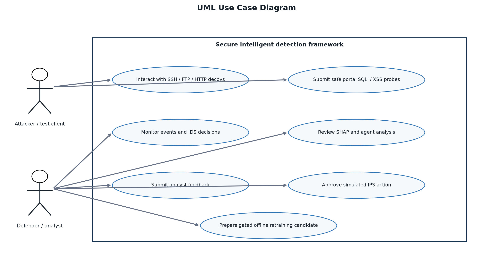
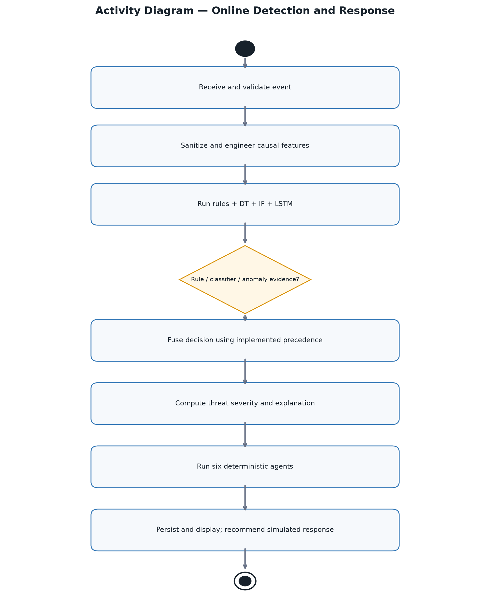
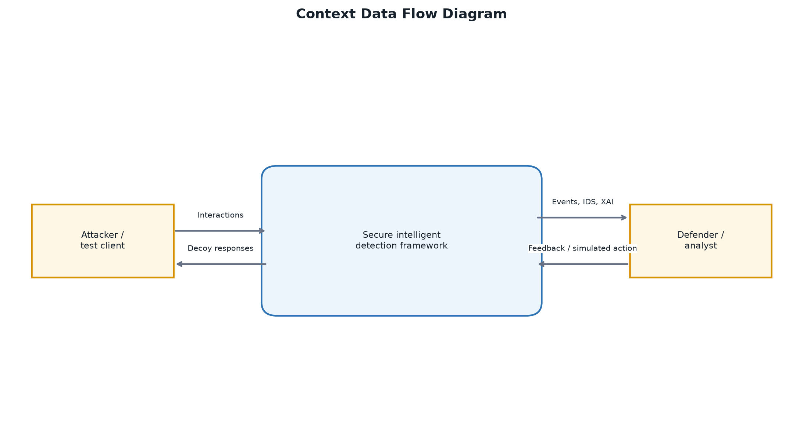
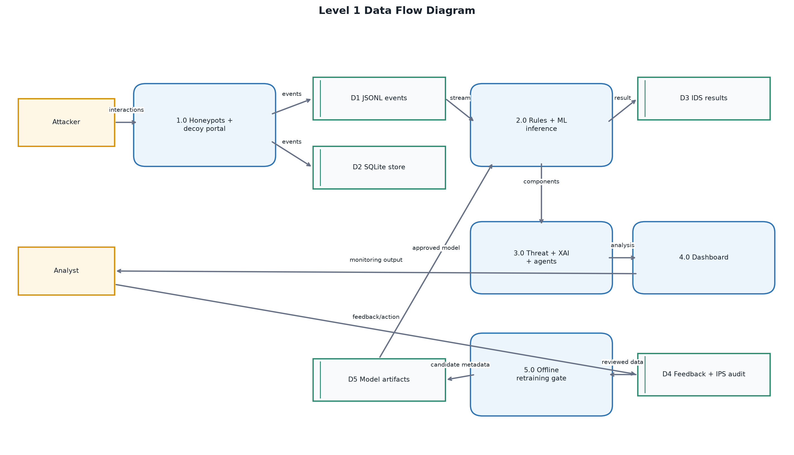

## 3.2 Implementation Details

The implemented prototype is a loopback-oriented defensive laboratory. SSH (2222), FTP (2121), and HTTP (8080) honeypots plus the React decoy portal (5173) create common-schema telemetry. The real-time pipeline validates and sanitizes each event, engineers causal features, runs deterministic rules and three saved-model roles, fuses the evidence, assigns a four-level threat score, adds a tree-SHAP explanation where supported, and invokes six deterministic operational agents. The Express/SQLite service (5000) persists telemetry and review records; the Flask defender dashboard (5050) displays the system monitor, honeypot activity, IDS/XAI/agents, analyst feedback, and simulation-only IPS records. The attacker portal remains separate from defender access.

### 3.2.1 Algorithm / Methodology / Techniques

#### Implemented workflow

1. **Capture.** Socket/HTTP services emulate bounded interactions; the portal safely simulates SQL-injection and XSS disclosures without dumping a real database or executing arbitrary JavaScript.
2. **Normalize and persist.** `core.event_schema` enforces the common event contract. `core.logger` writes JSONL, publishes SSE, and can queue events to the backend. Dataset preparation removes direct identifiers, hashes source IPs, records scope, redacts credentials, rejects invalid records, and deduplicates event IDs.
3. **Prepare evaluation data.** Dataset version 1.0 contains 4080 accepted events from 5193 input events; 1113 were rejected and 0 duplicate event IDs were removed. The active saved artifacts use a chronological 3264/816 split with no separate validation set. The LSTM robustness audit separately uses source-IP-hash group-isolated train/validation/test partitions for seeds 42–44, with preprocessing fitted only on each training partition.
4. **Engineer features causally.** History is grouped by pseudonymous source and service. Counts use current/past 60-second windows; username repetition and sessions use 300 seconds. Numerical missing values use training medians and standard scaling; categorical values use a training-fitted one-hot encoder with unknown values ignored. Direct IDs, free text, raw payload, and label are excluded.
5. **Infer and audit.** Rules, the selected Decision Tree, Isolation Forest, and active LSTM run from protected saved artifacts. LSTM sequences contain ten grouped causal steps and left-zero padding, which the model masks before the recurrent layer. The separate audit trained three candidate LSTMs only for evaluation; their checkpoints and matching preprocessors were preserved but were not promoted into runtime.
6. **Fuse.** A deterministic rule has first priority. Otherwise a tabular attack is used, averaging confidence only when LSTM agrees; next comes an LSTM non-normal class at confidence ≥0.60; then Isolation Forest may produce `other_anomaly` with null probability confidence. Otherwise the event is normal. Isolation score is `-decision_function`, not a probability.
7. **Explain and operationalize.** The tree explainer produces local SHAP contributions for the selected tabular model. Human text combines protected model evidence and fusion rationale. Six deterministic agents run in order: detection, correlation, severity review, explanation, response recommendation, and daily report. They are not LLM agents and cannot overwrite protected IDS fields.
8. **Review and response.** Analysts can inspect, filter, provide feedback, and approve simulated IPS actions. The policy never changes the host firewall; recommendations and actions remain auditable in SQLite.
9. **Learn offline.** Reviewed data can be prepared for candidate retraining, evaluated against quality gates, then promoted or rolled back with human control. This report's robustness audit trained isolated evaluation candidates, selected each best epoch by validation loss, and left the active checkpoint untouched.

#### Main pipeline pseudocode

```text
for each validated common_event in chronological order:
    neutral_event = remove producer attack label from inference input
    row = sanitize_and_normalize(neutral_event)
    features = causal_feature_engineering(row, prior_group_history)
    encoded = fitted_preprocessor.transform(features)
    rules = rule_detector.inspect(common_event)
    dt_label, dt_probability = selected_tree.predict(encoded)
    anomaly, anomaly_score = isolation_forest.predict(encoded)
    lstm_label, lstm_probability = lstm.predict(last_10_grouped_events)
    decision = implemented_precedence(rules, dt, lstm_at_0.60, anomaly)
    threat = stateful_threat_reporter.assess(decision)
    explanation = tree_SHAP_and_human_reason(encoded, decision)
    agents = run_in_fixed_order_without_mutating_protected_fields()
    persist_and_display(decision, threat, explanation, agents)
    recommend_simulation_only_response()
```

**Table 3.2.1-1. Implemented model roles and verifiable configuration**

| Component | Actual role | Verified configuration |
|---|---|---|
| Rules | Deterministic signature/threshold precedence | RuleBasedDetector; strongest rule wins |
| Decision Tree | Selected tabular known-attack classifier | gini, depth 12, leaf 2, balanced, seed 42 |
| Random Forest | Evaluated candidate; not selected | 200 trees, depth 16, sqrt, leaf 2, balanced_subsample, seed 42 |
| Isolation Forest | Unknown-anomaly signal | 200 estimators, contamination 0.05; fit on 431 normal training rows |
| LSTM (active runtime) | Causal sequence classifier; legacy chronological split | 23→64 hidden→8; 1 layer; dropout 0.30; sequence 10; 50 epochs; Adam lr 0.001; weighted CE; CPU |
| LSTM (audit candidates) | Leakage-resistant robustness evaluation; not promoted | Source-IP-hash group-isolated train/validation/test; seeds 42–44; max 40 epochs; best validation-loss checkpoint |

**Table 3.2.1-2. Production feature order and definition**

| Encoded feature | Definition / preprocessing |
|---|---|
| numeric__source_port | Raw numeric field, standardized using training-set statistics. |
| numeric__destination_port | Raw numeric field, standardized using training-set statistics. |
| numeric__username_present | Raw numeric field, standardized using training-set statistics. |
| numeric__session_id_present | Raw numeric field, standardized using training-set statistics. |
| numeric__failed_attempts | Failed events from the same pseudonymous source/service in the current and previous 60 seconds. |
| numeric__requests_per_minute | Events from the same pseudonymous source/service in the current and previous 60 seconds. |
| numeric__payload_length | Sanitized Step 6 payload length, with a safe text-length fallback. |
| numeric__session_duration | Seconds since the start of the current source/service activity session; a gap over 300 seconds starts a new session. |
| numeric__suspicious_keyword_count | General reconnaissance, sensitive-file and command-tool indicators found in sanitized request, payload and metadata text. |
| numeric__username_repetition | Earlier submissions of the same in-memory pseudonymized username by the source/service during the previous 300 seconds. |
| numeric__time_between_requests | Seconds since the previous event from the same source/service; zero for the first event. |
| numeric__sqli_xss_pattern_count | SQL-injection and cross-site-scripting pattern matches found in sanitized request, payload and metadata text. |
| categorical__source_ip_scope_loopback | One-hot category; unknown test categories ignored. |
| categorical__source_ip_scope_private | One-hot category; unknown test categories ignored. |
| categorical__service_ftp | One-hot category; unknown test categories ignored. |
| categorical__service_http | One-hot category; unknown test categories ignored. |
| categorical__service_ssh | One-hot category; unknown test categories ignored. |
| categorical__protocol_ftp | One-hot category; unknown test categories ignored. |
| categorical__protocol_http | One-hot category; unknown test categories ignored. |
| categorical__protocol_ssh | One-hot category; unknown test categories ignored. |
| categorical__request_method_get | One-hot category; unknown test categories ignored. |
| categorical__request_method_missing | One-hot category; unknown test categories ignored. |
| categorical__request_method_post | One-hot category; unknown test categories ignored. |

Source references: `core/honeypots/*`, `core/event_schema.py`, `core/logger.py`, `dataset/prepare_dataset.py`, `feature_engineering/engineer_features.py`, `preprocessing/preprocess_dataset.py`, `machine_learning/hybrid_ids.py`, `machine_learning/threat_reporting.py`, `XAI/prediction_explainer.py`, `intelligent_agents/orchestrator.py`, `website/backend/*.js`, `dashboard/app.py`, `continuous_learning/pipeline.py`, and `scripts/audit_lstm_generalization.py`.

### 3.2.2 Use Case Diagram / Activity Diagram / DFD



**Figure 3.2.2-1. UML use-case diagram.** The attacker/test client can interact only with decoys; the defender/analyst reviews evidence and controls feedback, simulated response, and offline candidate preparation.



**Figure 3.2.2-2. Activity diagram.** The activity follows the exact runtime order and distinguishes inference, explanation, agents, persistence, and recommendation-only response.



**Figure 3.2.2-3. Context DFD.** External boundary flows are interactions/decoy replies and defender evidence/feedback; the optional notification path is explicitly conditional.



**Figure 3.2.2-4. Level 1 DFD.** JSONL, SQLite, IDS results, review/audit data, and protected model artifacts are shown as separate stores. Offline retraining is separated from online inference.

Editable sources are supplied as PlantUML (`.puml`) and Mermaid (`.mmd`) alongside rendered PNG/SVG files.

### 3.2.3 Hardware and Software Specifications

Windows evaluation host: {'BuildNumber': '26200', 'Caption': 'Microsoft Windows 11 Pro', 'OSArchitecture': '64-bit', 'Version': '10.0.26200'}; CPU: {'Name': 'Intel(R) Core(TM) i5-10310U CPU @ 1.70GHz', 'NumberOfCores': 4, 'NumberOfLogicalProcessors': 8}; RAM/system: {'Manufacturer': 'Dell Inc.', 'Model': 'Latitude 5410', 'TotalPhysicalMemoryGB': 15.61}; GPU: {'AdapterRAMGB': 1, 'DriverVersion': '31.0.101.2135', 'Name': 'Intel(R) UHD Graphics'} (not used); storage: {'DriveLetter': 'D', 'FileSystem': 'NTFS', 'FreeGB': 192.32, 'SizeGB': 234.37}. Python 3.12.3, Node v22.23.1, npm 10.9.8.

The implementation uses Flask, Express, React/Vite, SQLite, NumPy, scikit-learn, Joblib, PyTorch, SHAP, psutil, and Matplotlib. Exact package versions are preserved in `environment.json`. The report run used CPU inference even if a GPU was installed. Browser screenshots beyond the included captured view require the manual checklist because no college template or browser-driver package was supplied.
