# 4 Result and Discussion

This chapter separates two scopes: fresh inference against the protected legacy holdout, and a three-seed LSTM robustness audit using source-group-isolated train/validation/test partitions. The audit fitted evaluation candidates but did not promote or overwrite the active runtime model. Protected artifact hashes were checked before and after the audit.

## 4.1 Sample of Inputs/Dataset/Database Used/ and Outputs/Screen Shots

**Table 4.1-1. Dataset summary (run 20260907_final_report_evidence)**

| Version | Input | Accepted | Rejected | Duplicates | Train | Validation | Test | Features |
|---|---|---|---|---|---|---|---|---|
| 1.0 | 5193 | 4080 | 1113 | 0 | 3264 | 0 | 816 | 23 |

**Table 4.1-2. Class distribution**

| Class | Total | Train | Test |
|---|---|---|---|
| normal | 510 | 431 | 79 |
| ssh_bruteforce | 510 | 400 | 110 |
| ftp_bruteforce | 510 | 380 | 130 |
| sql_injection | 510 | 411 | 99 |
| xss | 510 | 380 | 130 |
| directory_scanning | 510 | 401 | 109 |
| port_scanning | 510 | 376 | 134 |
| other_anomaly | 510 | 485 | 25 |

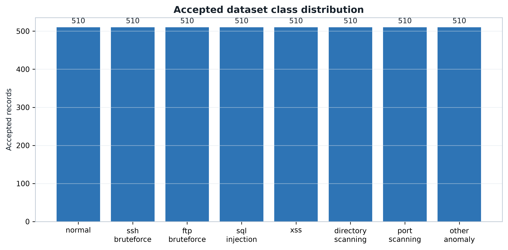

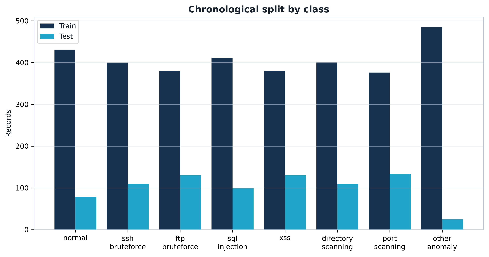

The data originated from `data/raw_logs/honeypot_events.jsonl` and the controlled expansion workflow, then was sanitized into `data/processed/honeypot_dataset.csv`. Representative rows are in `samples/sanitized_test_inputs.csv`; direct IPs, credentials, payload JSON, and personal identifiers are excluded.

The read-only database inventory found 6 application tables: analyst_feedback, honeypot_events, ids_results, ips_actions, ips_recommendations, users. Their exact columns, types, row counts, and sanitized IDS samples are in `samples/database_schema.json` and `samples/database_ids_results_sample.csv`. Relationships are mostly enforced by shared `event_id`/recommendation IDs in application code; SQLite foreign-key declarations were not found in the production schema and are not claimed.

Prediction-level outputs for every supported saved-model evaluation are in `predictions/`. Tabular rows use verified original event IDs; sequence rows use stable sequence sample IDs because the saved sequence array does not retain event IDs. Component probabilities, continuous attack scores, predictions, and truth labels are retained. The sanitized package includes `samples/live_events_sanitized.csv` plus `samples/live_ids_results.jsonl`; the complete isolated producer event stream stays only in the local run directory and is excluded from the ZIP.

Fresh isolated localhost demonstration: 125 events captured, 125 processed, 0 processing failures; external notification delivery was disabled. normal_http_get: 1 processed, 1 attack and 0 normal decisions (directory_scanning:1). ssh_bounded_bruteforce: 16 processed, 16 attack and 0 normal decisions (other_anomaly:1;ssh_bruteforce:15). ftp_bounded_bruteforce: 37 processed, 37 attack and 0 normal decisions (ftp_bruteforce:1;other_anomaly:8;ssh_bruteforce:28). http_supported_attacks: 71 processed, 70 attack and 1 normal decisions (directory_scanning:17;http_bruteforce:1;normal:1;sql_injection:42;xss:10). The isolated normal GET was classified as directory scanning, an observed false positive that requires follow-up.

Application screenshot evidence is tracked in `screenshots/manual_screenshot_checklist.csv`. Generated diagrams and charts are not represented as application screenshots. External Telegram receipt is pending by design because this run disabled notifications and did not expose secrets.

## 4.2 Evaluation Parameters

Let TP, TN, FP, and FN denote attack/normal outcomes, with **attack as positive** and normal as negative. Accuracy = (TP+TN)/(TP+TN+FP+FN). Precision = TP/(TP+FP). Recall or detection rate = TP/(TP+FN). F1 = 2·Precision·Recall/(Precision+Recall). FPR = FP/(FP+TN); FNR = FN/(FN+TP). Zero denominators are reported as zero by the evaluation implementation rather than causing an error.

For eight-class classification, per-class precision/recall/F1 and support are computed one-vs-rest. Macro averages give every class equal weight; weighted averages weight by support; balanced accuracy is mean class recall. Confusion matrices use actual classes as rows and predicted classes as columns; both raw counts and row-normalized proportions are reported.

ROC uses continuous `1-P(normal)` for supervised models and negative Isolation Forest `decision_function` for anomaly detection. ROC-AUC integrates TPR against FPR. The precision-recall curve also uses continuous scores, and `average_precision_score` is reported (stepwise average precision, not trapezoidal PR-AUC). The anomaly score direction was checked so higher means more anomalous and is not called a calibrated probability.

Latency is wall-clock inference time after artifact loading, with one warm-up and 12 repeated batches of 816 samples; median, mean, p95, and per-sample derived values are preserved. If live mode was run, `e2e_local_processing_ms` spans event-to-result computation inside the evidence harness (hybrid inference, threat/XAI and agents), excluding network capture and backend persistence. Functional test pass rates are not presented as detection accuracy.

## 4.3 Performance Evaluation (Tables/Graphs/Charts)

**Table 4.3-1. Primary reported multiclass metrics by evaluation scope**

| Model | Evaluation scope | Runs | Test n | Accuracy | Accuracy SD | Balanced accuracy | Macro F1 | Macro F1 SD |
|---|---|---|---|---|---|---|---|---|
| Decision Tree | legacy chronological holdout | 1 | 816 | 0.9804 | n/a | 0.9465 | 0.9582 | n/a |
| Random Forest | legacy chronological holdout | 1 | 816 | 0.9645 | n/a | 0.9408 | 0.9510 | n/a |
| LSTM | source-group-isolated holdouts | 3 | 710/710/711 | 0.9761 | 0.0035 | 0.9785 | 0.9675 | 0.0033 |

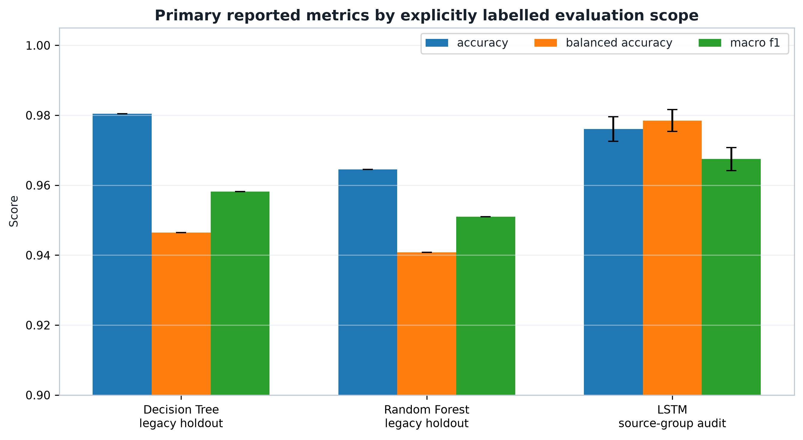

Decision Tree remains the selected tabular classifier: its macro F1 is approximately 0.958 while Random Forest is approximately 0.951 and has a materially larger normal-event false-positive rate. The primary LSTM row now uses the three-run source-group-isolated estimate: 0.9761 accuracy and 0.9675 macro F1. The legacy 1.0000 reproduction appears only in the explicitly labelled comparison below and must not be quoted as the final generalization result.

**Table 4.3-2. LSTM evaluation-scope comparison**

| Evaluation | Runs | Test n | Accuracy mean | Accuracy SD | Balanced accuracy | Macro F1 mean | Macro F1 SD | Source-group overlap | Template overlap |
|---|---|---|---|---|---|---|---|---|---|
| legacy chronological holdout | 1 | 816 | 1.0 | 0.0 | 1.0 | 1.0 | 0.0 | 791/816 test rows | 816/816 test rows |
| source-group-isolated holdouts | 3 | 710, 710, 711 | 0.9760675633736786 | 0.003450022077343988 | 0.9785477039979603 | 0.9675284795903893 | 0.003261310821230083 | 0 in every run | templates still repeat across groups |

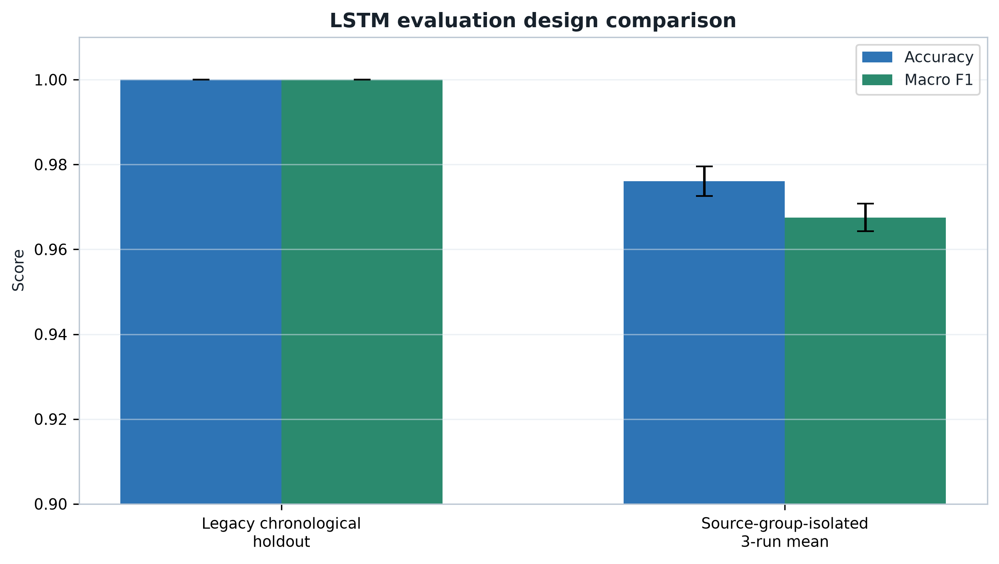

The original chronological split has important dependence: 791 of 816 test rows (96.94%) have a source hash already present in training, all 816 reuse a service/event/path template found in training, and the train-end and test-start timestamps are identical. There are no byte-identical train/test sequences, so the concern is related-group/template overlap rather than literal sequence duplication. In three source-group-isolated runs, source overlap was zero in every run. Test accuracy was 0.9761 mean with 0.0035 population standard deviation (range 0.9718–0.9803); macro F1 was 0.9675 mean with 0.0033 standard deviation (range 0.9635–0.9715). These are the preferred internal LSTM estimates. Templates still repeat across groups, so an external or template/campaign-isolated dataset remains necessary. Seed-level results and exact split assignments are packaged under `lstm_robustness/`. The seed-42 bundle is a reproducible candidate only; it was not promoted.

**Table 4.3-3. Source-group-isolated LSTM seed-level results**

| Seed | Best epoch | Train | Validation | Test | Validation accuracy | Test accuracy | Balanced accuracy | Macro F1 |
|---|---|---|---|---|---|---|---|---|
| 42 | 38 | 2779 | 591 | 710 | 0.9712351945854484 | 0.9802816901408451 | 0.9824306518723994 | 0.9715243272238656 |
| 43 | 40 | 2778 | 592 | 710 | 0.9847972972972973 | 0.971830985915493 | 0.9748043892461368 | 0.9635357816820458 |
| 44 | 39 | 2778 | 591 | 711 | 0.9847715736040609 | 0.9760900140646976 | 0.9784080708753448 | 0.9675253298652567 |

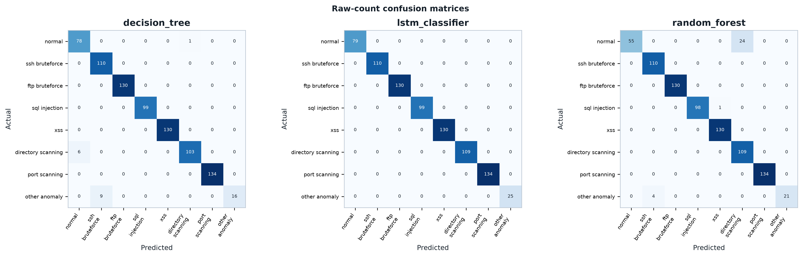

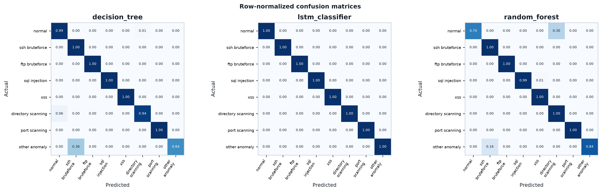

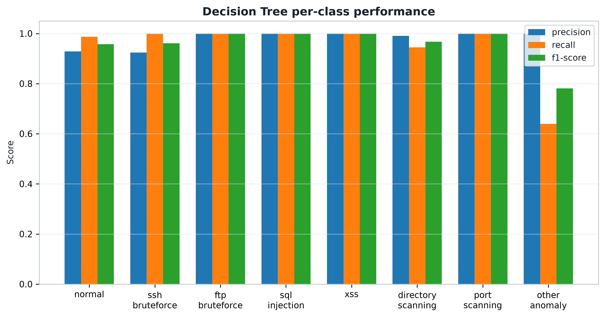

**Table 4.3-4. Binary attack-versus-normal evaluation**

| Model | n | TN | FP | FN | TP | FPR | FNR | ROC-AUC | Average precision | Continuous score |
|---|---|---|---|---|---|---|---|---|---|---|
| decision_tree | 816 | 78 | 1 | 6 | 731 | 0.012658227848101266 | 0.008141112618724558 | 0.9998969479415352 | 0.9999889686820884 | 1 - P(normal) |
| random_forest | 816 | 55 | 24 | 0 | 737 | 0.3037974683544304 | 0.0 | 1.0 | 1.0 | 1 - P(normal) |
| lstm_classifier | 816 | 79 | 0 | 0 | 737 | 0.0 | 0.0 | 1.0 | 0.9999999999999999 | 1 - P(normal) |
| isolation_forest | 816 | 79 | 0 | 723 | 14 | 0.0 | 0.9810040705563093 | 0.9357642168902324 | 0.9929100774400685 | negative decision_function; continuous, not calibrated probability |

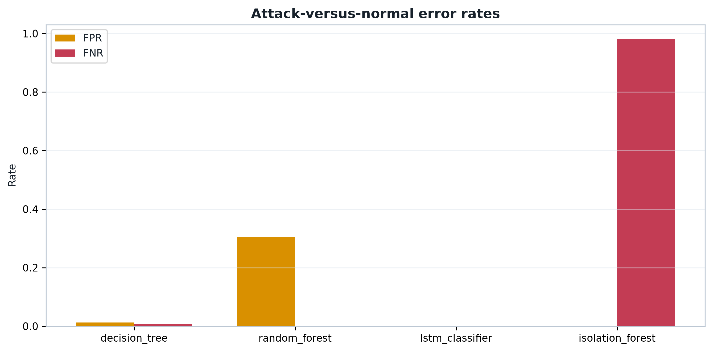

Isolation Forest ranks attacks well (ROC/PR evidence in the CSV) but at its saved contamination operating point detects only a small fraction of attacks. This is not directly comparable to eight-class accuracy and indicates threshold calibration work, not a failed classifier replacement.

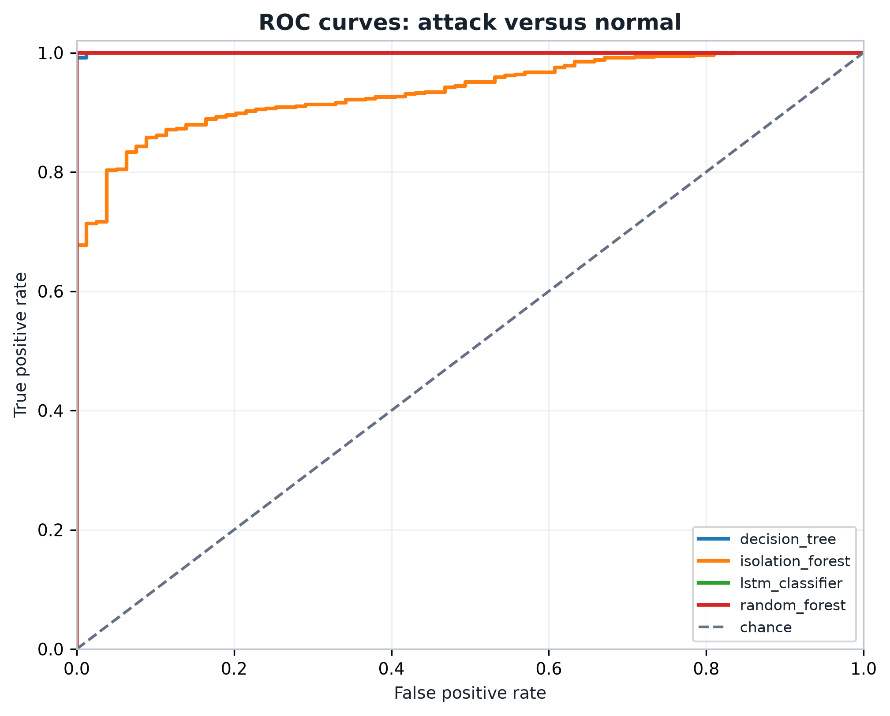

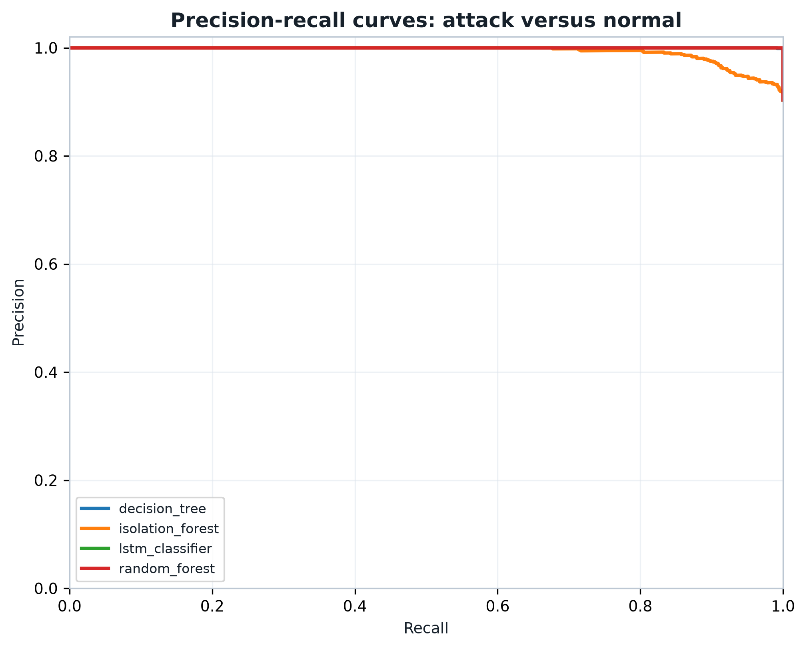

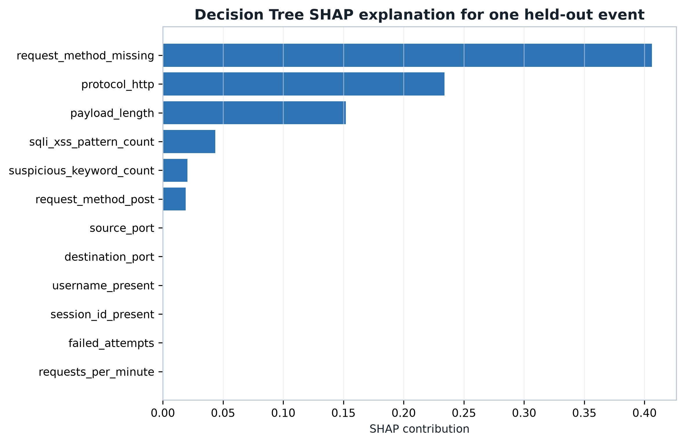

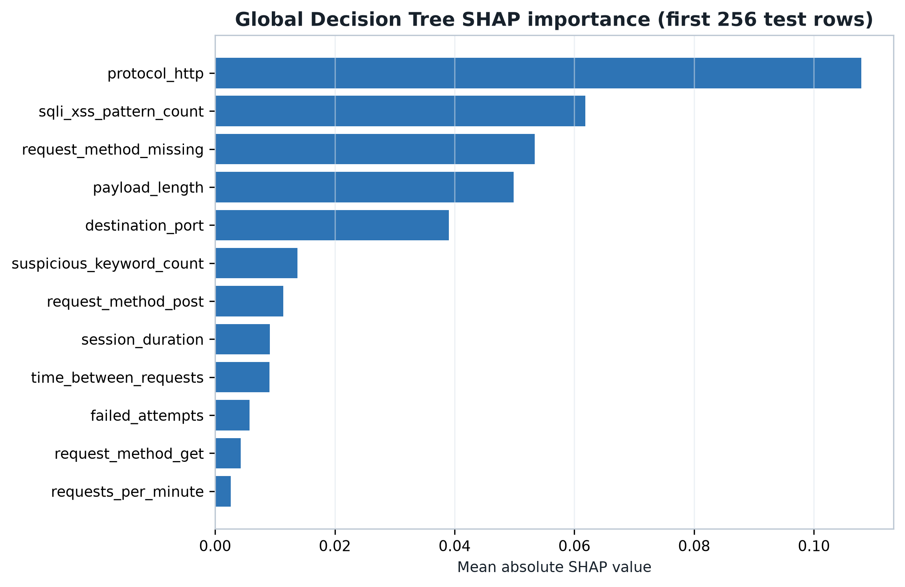

The global SHAP plot is mean absolute contribution on the first 256 chronologically held-out tabular rows; the local plot is one traceable held-out event. SHAP describes the selected tree's contribution, not the rule, LSTM, anomaly model, or a causal explanation of attacker intent.

**Table 4.3-5. CPU inference latency**

| Model | n | Median batch ms | Mean batch ms | p95 batch ms | Median ms/sample |
|---|---|---|---|---|---|
| decision_tree | 816 | 0.17615 | 0.18694999999999998 | 0.234875 | 0.0002158700980392157 |
| random_forest | 816 | 23.10485 | 22.97045 | 23.497525 | 0.028314767156862743 |
| lstm_classifier | 816 | 14.9285 | 14.449466666666666 | 16.10932 | 0.01829473039215686 |
| isolation_forest | 816 | 22.8482 | 23.475233333333332 | 28.720885 | 0.028000245098039212 |

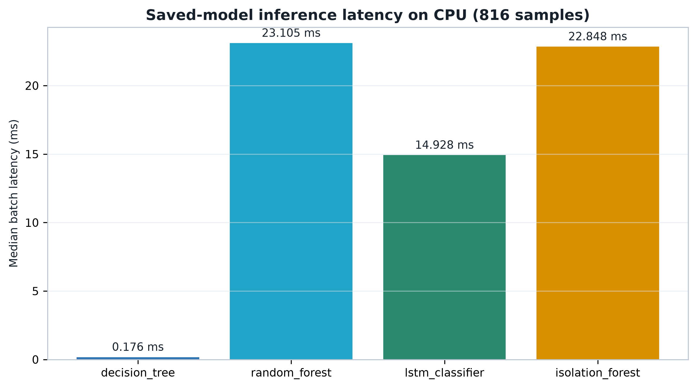

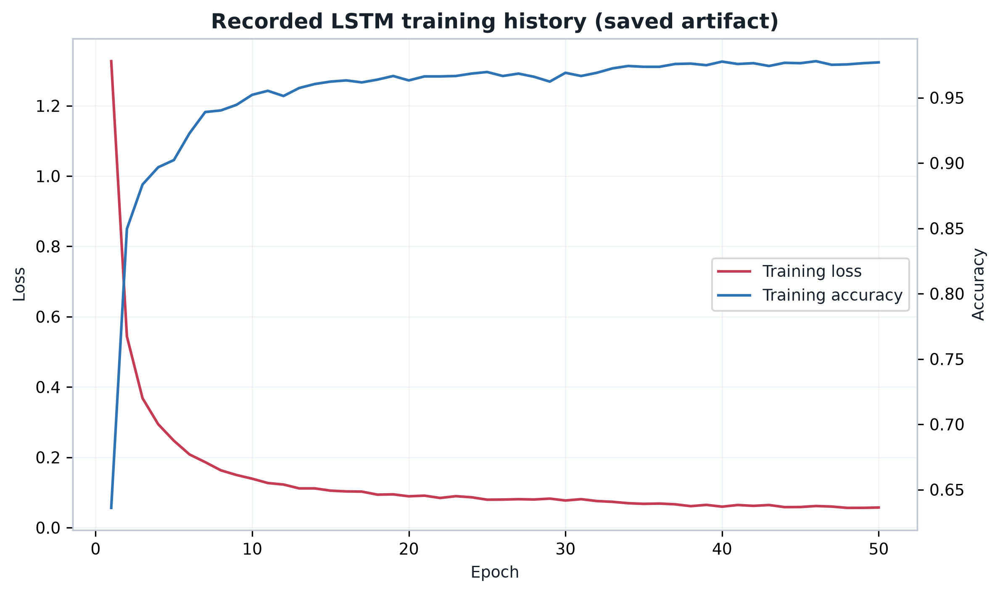

Rules-only and full-hybrid aggregate accuracy are intentionally not fabricated: the saved feature arrays omit the raw stateful event stream required for a faithful, directly aligned replay. Live mode demonstrates the real runtime path separately but its scenario labels and small controlled sample do not constitute a generalization benchmark. Source-group isolation has now been measured for LSTM, but external/template/campaign isolation, calibration and sustained-load evaluation remain open. Exact unsupported/missing evidence is listed in `limitations_and_missing_evidence.md`.
